<table>
<colgroup>
<col style="width: 49%" />
<col style="width: 50%" />
</colgroup>
<thead>
<tr>
<th rowspan="2"></th>
<th>AN23000</th>
</tr>
<tr>
<th>V1.0</th>
</tr>
</thead>
<tbody>
</tbody>
</table>

说明

CH32X035、CH32H417、CH32V205等系列MCU产品配备了一个称为PIOC的外设。本文以CH32X035及配套1_Wire工程为例，介绍PIOC的执行结构、主机数据交互和时序设计，并通过WS2812单线驱灯说明程序装载、汇编取数、逐位发送及结果处理的方法。

**适用范围**

| 适用范围 | 系列                                  |
|----------|---------------------------------------|
| 通用MCU  | CH32X035、CH643、CH32V205、CH32H41x等 |

目录

[说明 [1](#_Toc244868322)](#_Toc244868322)

[目录 [2](#_Toc244868323)](#_Toc244868323)

[表格索引 [2](#_Toc244868324)](#_Toc244868324)

[图片索引 [2](#_Toc244868325)](#_Toc244868325)

[第1章 PIOC功能结构 [1](#pioc功能结构)](#pioc功能结构)

[1.1 结构总览 [1](#结构总览)](#结构总览)

[1.2 主机与PIOC交互 [2](#主机与pioc交互)](#主机与pioc交互)

[1.3 时序设计 [3](#时序设计)](#时序设计)

[第2章 WS2812单线驱灯示例 [6](#ws2812单线驱灯示例)](#ws2812单线驱灯示例)

[2.1 协议时序窗口 [6](#协议时序窗口)](#协议时序窗口)

[2.2 工程组成及初始化 [6](#工程组成及初始化)](#工程组成及初始化)

[2.3 命令字与结果码 [6](#命令字与结果码)](#命令字与结果码)

[2.4 短帧与长帧路径 [7](#短帧与长帧路径)](#短帧与长帧路径)

[2.5 主机调用与一次完整发送
[9](#主机调用与一次完整发送)](#主机调用与一次完整发送)

[历史版本 [10](#_Toc244868336)](#_Toc244868336)

[声明 [11](#_Toc244868337)](#_Toc244868337)

表格索引

[PIOC主要特性 [1](#_Toc244868338)](#_Toc244868338)

[示例工程主要文件 [6](#_Toc244868339)](#_Toc244868339)

[例程的命令字分配 [7](#_Toc244868340)](#_Toc244868340)

[主机两种发送接口的操作顺序 [9](#_Toc244868341)](#_Toc244868341)

图片索引

[CH32X035 PIOC结构 [1](#_Toc244868342)](#_Toc244868342)

[命令与结果的三个状态位 [2](#_Toc244868343)](#_Toc244868343)

[两种数据传递方式 [2](#_Toc244868344)](#_Toc244868344)

[软件分配两块SFR缓冲 [3](#_Toc244868345)](#_Toc244868345)

[指令占用与边沿间隔 [4](#_Toc244868346)](#_Toc244868346)

[PIOC两种位调制 [4](#_Toc244868347)](#_Toc244868347)

[定时器模式的计数 [5](#_Toc244868348)](#_Toc244868348)

[PWM模式的计数 [5](#_Toc244868349)](#_Toc244868349)

[WS2812位定义 [6](#_Toc244868350)](#_Toc244868350)

[代码中三条路径 [7](#_Toc244868351)](#_Toc244868351)

[软件位时序 [8](#_Toc244868352)](#_Toc244868352)

# PIOC功能结构

## 结构总览

<figure>
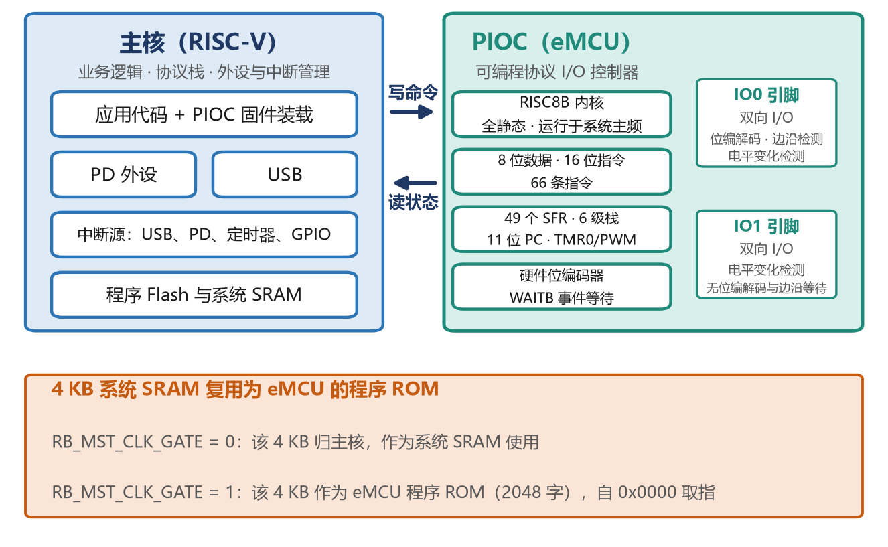
<figcaption>
图 1‑1 CH32X035 PIOC结构
</figcaption>
</figure>

PIOC是芯片内部集成的可编程协议I/O控制器，手册中亦称eMCU。其内部为RISC8B内核，拥有独立的程序空间、寄存器组与指令流，可在不占用主机中断与调度资源的前提下，按确定的指令周期在两根引脚上产生协议波形。

从使用方式看，主机与PIOC之间的交互集中在三个环节：装载（把编译好的指令写入共享SRAM并交由PIOC取指）、下发任务（写入命令与参数）、读取结果（事务结束后读取结果码）。完成装载后，协议执行由PIOC独立完成，主机可继续执行其它任务。因此，PIOC的定位可以概括为：一颗可由用户编程的8位协议控制器，用于实现时序确定、速率中等、引脚数量少的接口。其功能由用户编写的汇编程序定义，而非由芯片固定。

| **特性**     | **规格**                                     |
|:-------------|:---------------------------------------------|
| **内核**     | RISC8B，8位数据、16位指令、66条指令。        |
| **运行频率** | 与系统主频相同，全静态设计，时序按周期计算。 |
| **程序空间** | 2048字（4KB），由系统SRAM复用                |
| **寄存器**   | 49个SFR（0x00–0x3F），含33字节数据寄存器     |
| **堆栈**     | 6级，11位宽                                  |
| **引脚**     | 2路双向I/O，支持电平变化检测                 |
| **位编解码** | PWM（25%/75%）与Manchester，位宽可编程       |
| **定时器**   | 8位主动重加载定时器T0，定时器/PWM两种模式    |
| **装载方式** | 支持暂停与动态加载                           |

表 1‑1 PIOC主要特性

## 主机与PIOC交互

<figure>
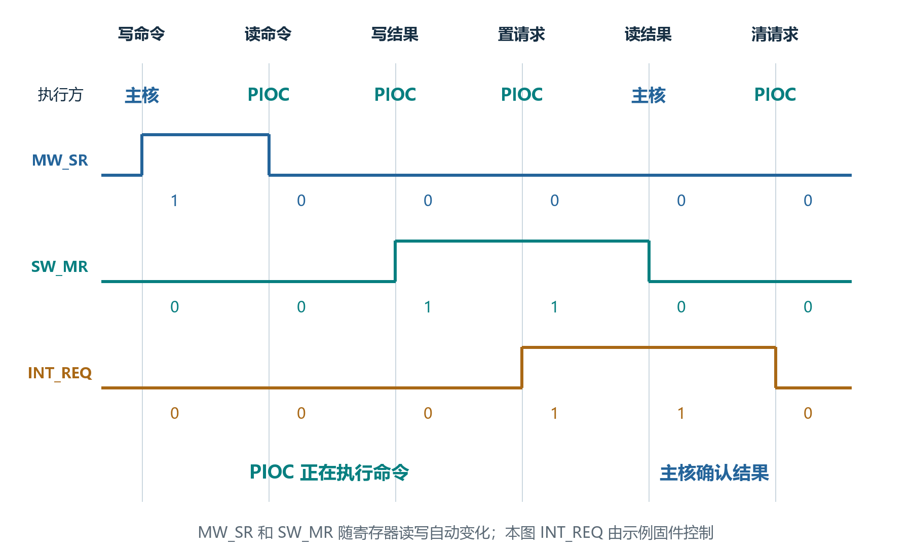
<figcaption>
图 1‑2 命令与结果的三个状态位
</figcaption>
</figure>

MW_SR表示命令是否已被PIOC取走（主机写入CTRL_WR后MW_SR自动置1，PIOC读取CTRL_WR后MW_SR自动清0,只表示命令已被取走，此时协议处理可能刚开始。只有结合本次提交动作，才能解释这个标志，不能把初始值0当作完成）；

SW_MR表示结果是否已被主机读取（PIOC写入CTRL_RD后SW_MR自动置1，主机读取CTRL_RD后DATA_SW_MR自动清0）；

INT_REQ由PIOC置位，用于向主机请求中断或取消请求，主机读走结果后由固件清INT_REQ。主机可以通过对只读寄存器CTRL_RD的假写操作实现对INT_REQ清0，主机写CTRL_RD对其中数据无实际影响。

<figure>
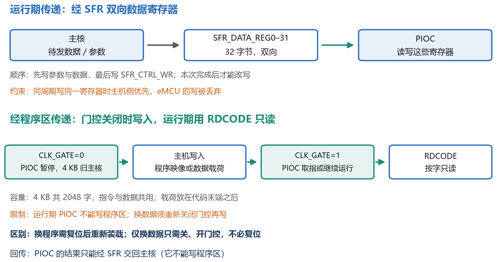
<figcaption>
图 1‑3 两种数据传递方式
</figcaption>
</figure>

SFR方式适合参数和少量数据。双方先约定寄存器用途，例如DATA0由主机提交前写入，DATA1由PIOC执行时写入，主机收到完成通知后读取。主机与PIOC同周期写同一共享寄存器时，主机写优先，PIOC写被丢弃。

程序区方式适合较多的只读数据或常量表。该4KB在CLK_GATE=0时归主机、CLK_GATE=1时作为PIOC程序ROM，因此写入必须在门控关闭（或保持复位）期间完成；写完再把CLK_GATE置1。PIOC读取时使用RDCODE：把目标地址低8位写入SFR_INDIR_ADDR、高3位写入A寄存器，一次取回16位数据，地址按11位字地址计算。程序区共2048字，指令与数据共用；PIOC只能读、不能写，它产生的结果只能经SFR交回主机；CLK_GATE=1期间主机也不得写这块区域，需要更新数据时必须重新关闭门控。

<figure>
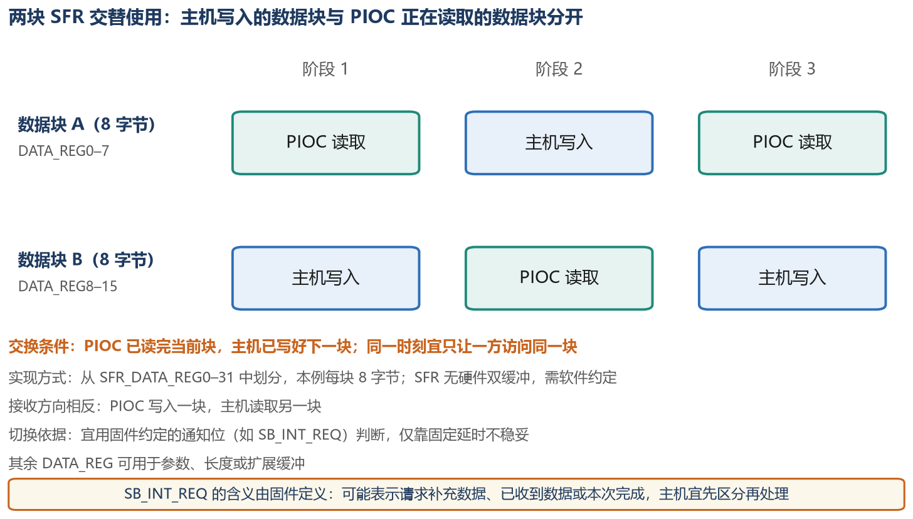
<figcaption>
图 1‑4软件分配两块SFR缓冲
</figcaption>
</figure>

单次数据放不下时，可以把可用DATA_REG分成两块。PIOC读取A时，主机只写B；交换前必须同时满足“A已读完”和“B已准备好”。接收方向反过来：PIOC写入空块，主机读取已完成块。块长度、有效标志、最后一块长度和超时处理都需要软件定义。EVT示例中UART、IIC等例程包含分段数据通知，可参考其寄存器分配与计数方式。

## 时序设计

PIOC基于单时钟周期的精简指令集RISC8B内核，运行于系统主频，时序设计以指令周期为单位。协议手册给出的通常是纳秒或微秒，需先换算为周期数。PIOC没有专用延时指令，延时由执行空操作构成，按长度可分为三档：1～10周期可采用连续NOP；10～100周期可调用一个含n条NOP的子程序（周期数为n+4，CALL与RET各占2个周期）；长周期可采用计数循环，每轮DEC与JNZ合计3个周期。

把一段代码换算成波形，只需沿执行路径累加周期。下例假设IO0已配置为软件输出，位编码与定时器输出均已关闭：

    PULSE:  BS    SFR_PORT_IO,SB_PORT_OUT0
            NOP
            NOP
            NOP
            BC    SFR_PORT_IO,SB_PORT_OUT0
            NOP
            NOP
            NOP
            JMP   PULSE

图中按指令完成边界表示输出锁存值的变化：第一条BS完成于t=1，BC完成于t=5，下一轮BS完成于t=11。高电平为4周期，低电平为6周期，48MHz下每周期约20.833ns，名义高、低电平分别约83.333ns和125ns。普通传送、运算和位操作通常为1周期；JMP、CALL和返回为2周期；条件转移成立或发生跳过时计入额外周期；RDCODE为3周期。WAITB的总时间由事件何时成立决定，不能把等待时间作为固定的单周期延时。

<figure>
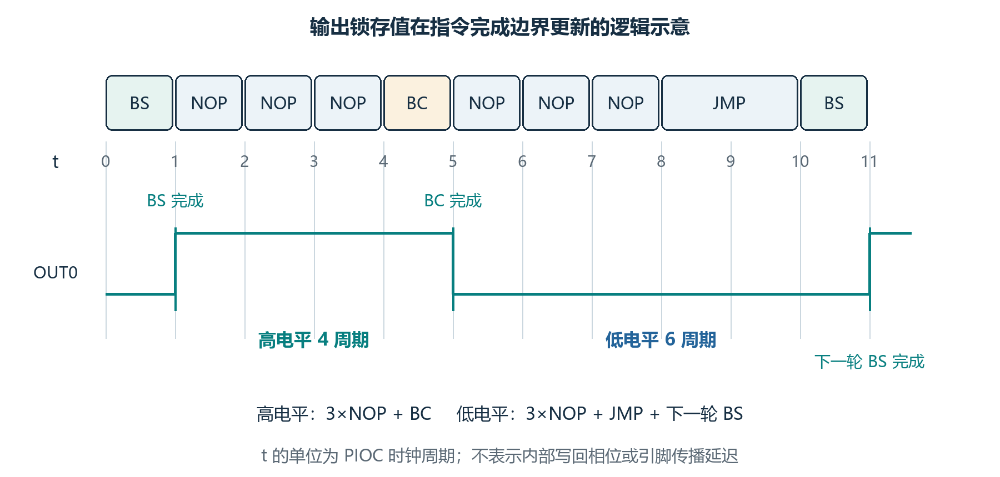
<figcaption>
图 1‑5 指令占用与边沿间隔
</figcaption>
</figure>

位编解码用于逐位重复相同波形的协议：配置位宽与编码方式后，向BIT_CYCLE的bit7写入数据位，硬件即产生一个完整位周期，CPU可同时处理下一位；PWM模式下0占25%、1占75%；Manchester模式下0不翻转、1在中点翻转；TAIL=1表示已进入后25%，本位编解码完成。写入BIT_CYCLE即启动位周期，无需额外的启动位；写该寄存器会清除IO0的边沿检测记录，若此时正在用WAITB等待边沿会受到影响。位宽字段写0时关闭编解码。

<figure>
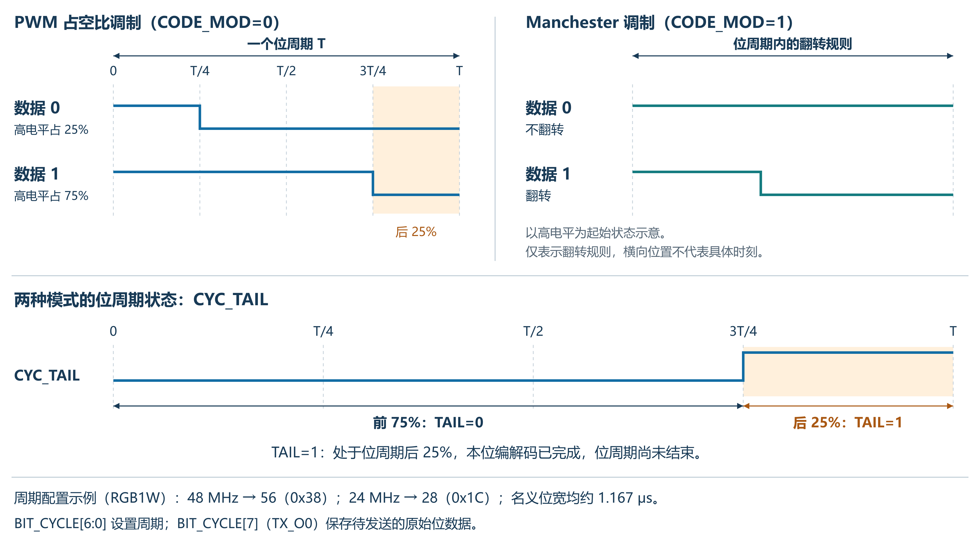
<figcaption>
图 1‑6 PIOC两种位调制
</figcaption>
</figure>

WAITB是PIOC中用于事件同步的指令。条件不成立时，程序计数器保持不变，反复执行该指令；条件满足后继续执行下一条。八种事件覆盖了主要同步需求：

等待主机写入命令（WB_DATA_MW_SR_1）；

等待主机读取结果（WB_DATA_SW_MR_0）；

等待位周期进入后25%位编解码完成（WB_BIT_CYC_TAIL_1）；

等待IO0上升沿或下降沿（WB_PORT_I0_RISE/FALL）；

等待IO0\IO1输入与输出不同或恢复一致（WB_PORT_XOR0_1/0、WB_PORT_XOR1_1）。

两个语义细节影响其使用方式：边沿类事件在退出时会清除检测记录，因此连续两次等待上升沿不会因上次已检测到而立即返回；条件类事件若已成立则立即退出。PORT_XORx表示输入与输出锁存值的异或结果。若OUT0=1，XOR0=1说明输入为低；若OUT0=0，同样的XOR0=1却说明输入为高。因此WAITB
WB_PORT_XOR0_1不能一律解释为“等低电平”，必须先明确OUT的参考值。

输入采样时刻还受SB_PORT_IN_EDGE选择：为0时在时钟周期中点采样，为1时取前一周期的边沿值。设计接收程序时，应先定位起始条件，再把采样点安排在有效窗口内，检测到边沿并不等于下一个指令就能采到位中心。

PIOC提供一个8位定时器0，TMR0_COUNT保存当前值，TMR0_INIT保存重装初值I，TIMER_CTRL选择分频、模式和输出。时钟由SB_TMR0_FREQ从系统主频分频得到，分频字段000–111依次对应D=1024、256、64、16、8、4、2、1。定时器0可以工作于定时器模式或脉宽调制器模式。定时模式下，计数从TMR0_INIT计到0xFF后溢出并重装初值；PWM模式的周期固定为256个定时器时钟，初值改为决定比较阈值。

<figure>
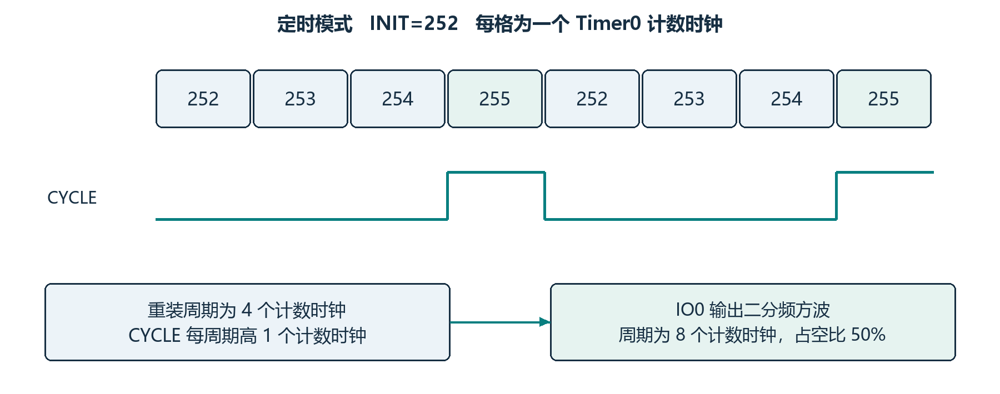
<figcaption>
图 1‑7 定时器模式的计数
</figcaption>
</figure>

定时模式从I计到255，再重装I。重装周期为(256−I)×D/Fpioc；内部CYCLE在计数到255时为高，重装时回低。允许输出后，IO0输出该周期信号的二分频方波，频率Fpioc/\[2×D×(256−I)\]，占空比为50%。

<figure>
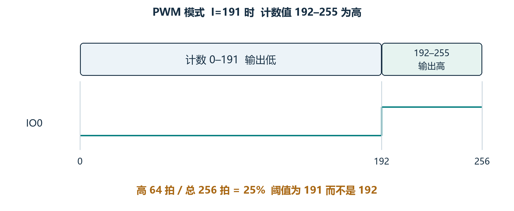
<figcaption>
图 1‑8 PWM模式的计数
</figcaption>
</figure>

PWM模式始终从0计到255，再回到0，周期为256×D/Fpioc。INIT在此模式中是比较阈值，不再改变计数周期；COUNT\>I时内部CYCLE为1，在引脚由PIOC接管、方向为输出且定时输出允许时，该信号作用于IO0。高电平占空比为(255−I)/256。

# WS2812单线驱灯示例

## 协议时序窗口

<figure>
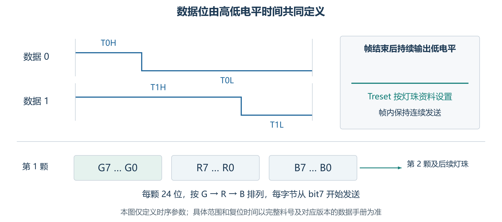
<figcaption>
图 2‑1 WS2812位定义
</figcaption>
</figure>

判断时序是否合格，应分别核对T0H、T0L、T1H、T1L和帧结束复位低电平，0与1的差别仅在于高电平占比。常见24位WS2812B每颗使用3字节，按G、R、B排列，每字节先发送bit7。多颗级联时，顺序放入第1颗至最后一颗的数据；每颗截取属于自己的24位，其余数据经DOUT转发。以00h、20h、00h为例，表示绿色和蓝色分量为0、红色分量为20h。RGBW等器件应另行确认字节数和色序。WS2812其协议简单而时序要求严格：仅由0与1两种位构成，位宽容差±150ns，数据量可从小到大，且要求一次连续发送。本地例程EXAM\PIOC\1_Wire同时实现了短帧（SFR）与长帧（程序区载荷）两条路径，可用于说明同一协议的两种实现方式。

## 工程组成及初始化

| **文件**              | **阅读或修改重点**                               |
|:----------------------|:-------------------------------------------------|
| Asm/RGB1W.ASM         | 命令分派、SFR与RAM取数、位时序、帧结束和结果返回 |
| Asm/PIOC_INC.ASM      | PIOC侧寄存器、位号及专用指令参数                 |
| Asm/RGB1W.BAT         | 调用WASM53B汇编，并用BIN_HEX转换C数组            |
| User/RGB1W.c与RGB1W.h | 主机初始化、程序数组、缓冲区地址和发送接口       |
| Ld/Link.ld            | 主机RAM范围及与PIOC复用SRAM的隔离                |

表 2‑1 示例工程主要文件

RGB1W_Init依次使能AFIO、GPIOC和PIOC时钟，选择PC18/PC19或重映射后的PC7，设置引脚复用；随后令PIOC保持复位且CLK_GATE=0，将PIOC_1W_CODE复制到PIOC_SRAM_BASE。该函数完成装载，实际发送接口再释放复位、开启PIOC时钟并提交任务。

主机链接脚本将普通RAM限制为从0x20000000开始的16KB；PIOC复用区从0x20004000开始，共4KB。移植时保留这种隔离，避免主机的栈、堆或全局变量占用PIOC程序区。使用PC18/PC19时还需处理与调试接口的复用关系；仅使用重映射后的IO0时，应同步检查各发送函数中的IO_EN配置。

## 命令字与结果码

主机先准备数据和参数，最后写CTRL_WR提交命令。以下命令是例程约定的接口范围，不等于所有能进入汇编分支的数值都适合调用。RAM路径将字节总数放在DATA_REG0/1，将通道选择放在DATA_REG2
bit0；SFR路径则用DATA_REG0～31存放待发字节。

<table>
<caption>
表 2‑2 例程的命令字分配
</caption>
<colgroup>
<col style="width: 15%" />
<col style="width: 29%" />
<col style="width: 32%" />
<col style="width: 23%" />
</colgroup>
<thead>
<tr>
<th style="text-align: center;"><strong>命令</strong></th>
<th style="text-align: center;"><strong>含义</strong></th>
<th style="text-align: center;"><strong>数据来源</strong></th>
<th style="text-align: center;"><strong>通道</strong></th>
</tr>
</thead>
<tbody>
<tr>
<td style="text-align: left;">0x01–0x20</td>
<td style="text-align: left;">
短帧，低7位为字节数

（1–32）
</td>
<td style="text-align: left;">DATA_REG0起的SFR</td>
<td style="text-align: left;">IO0</td>
</tr>
<tr>
<td style="text-align: left;">0x44–0x60</td>
<td style="text-align: left;">短帧，低6位为字节数</td>
<td style="text-align: left;">DATA_REG0起的SFR</td>
<td style="text-align: left;">IO1</td>
</tr>
<tr>
<td style="text-align: left;">0x88–0xFC</td>
<td style="text-align: left;">长帧，低7位为位宽 N</td>
<td style="text-align: left;">程序区载荷（RDCODE）</td>
<td style="text-align: left;">由DATA_REG2选择</td>
</tr>
<tr>
<td style="text-align: left;">0x41–0x43</td>
<td style="text-align: left;">DS18B20</td>
<td style="text-align: left;">—</td>
<td style="text-align: left;">IO0</td>
</tr>
</tbody>
</table>

IO1短帧接口将长度与0x40合成命令。长度1～3对应0x41～0x43，会先进入温度传感器分支，因此单颗RGB灯的3字节数据不能直接通过该原始IO1短帧命令发送。应重新分配冲突命令并同步修改C与ASM，或采用已经修正且验证过的其他发送路径。用于完整RGB灯链时，字节数还应为3的整数倍。

任务完成时，PIOC先写CTRL_RD，再置INT_REQ并返回WAIT_COMMAND。主机轮询等待接口通过INT_REQ判断完成，读取CTRL_RD取得结果；随后PIOC检查到SW_MR=0，再清INT_REQ。若改用中断方式，应由中断服务程序统一读取结果并通知应用层，避免轮询代码和中断重复读取同一个完成状态。

## 短帧与长帧路径

<figure>
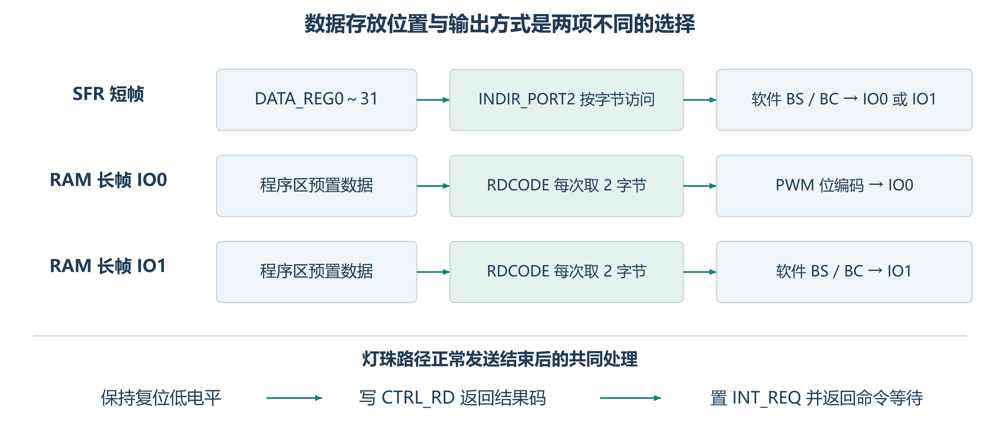
<figcaption>
图 2‑2 代码中三条路径
</figcaption>
</figure>

SFR路径一次最多传递32字节，可容纳10颗完整RGB灯的数据。入口关闭位编码，设置对应OUT锁存值为低、配置输出方向，并检查输入是否为低。随后用INDIR_ADDR
保存剩余字节数，用MOVIA 将第二组间接地址INDIR_ADDR2指向DATA_REG0。

            BS    SFR_PORT_IO,SB_PORT_OUT0   ; 上升沿
            CALL  RGB1W_DLY_0H              ; 高电平 292 ns
            BTSS  SFR_INDIR_PORT2,7         ; 数据位为 1 则跳过
            BC    SFR_PORT_IO,SB_PORT_OUT0  ; 数据 0：提前拉低
            CALL  RGB1W_DLY_HALF            ; 补齐至中点
            BC    SFR_PORT_IO,SB_PORT_OUT0  ; 数据 1：在此拉低
            CALL  RGB1W_DLY_1L              ; 低电平 292 ns
            ; … bit6～bit0 同样展开，最后一位使用 _B0 变体补偿指针推进

这段代码处理一个普通数据位。数据为 0
时，BTSS不跳过第一次BC，输出较早拉低；数据为1
时跳过该BC，保持高电平直到第二次BC。DLY_HALF用于补足中间时段，并不是把信号拉低到位周期中点。两条数据路径都要包含BTSS是否跳过及CALL/RET的开销。

<figure>
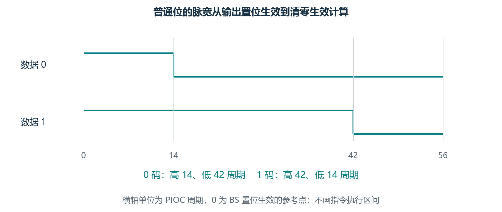
<figcaption>
图 2‑3 软件位时序
</figcaption>
</figure>

DLY_0H为8条NOP加RET，共10周期；DLY_1L为11周期；DLY_HALF含嵌套调用及顺序执行到DLY_1L的路径，本体为25周期。计入调用和分支后，普通位的T0H/T0L为14/42周期，T1H/T1L为42/14周期。48MHz下分别约为0.292/0.875us和0.875/0.292us，位周期约1.167us。

bit7～bit1的位检查不会自动推进数据指针；字节末尾通过MOV
SFR_INDIR_PORT2,A触发INDIR_ADDR2自增，再递减字节计数。bit0使用_B0延时入口补偿取数和循环开销。修改时不能只调整普通位的NOP，应同时核算字节末位、连续字节及最后一位后的收尾路径。

RAM长帧的取数与位编码:

RAM路径把数据预先放入PIOC程序区，借助RDCODE每次读取一个16位字。数据在A和INDIR_ADDR中分别得到低、高字节，因此先发送低字节，再发送高字节；每个字节内部仍按bit7到bit0发送。VAR_ADDR_L/H另存下一次取数地址，VAR_SIZE_L/H记录剩余字节数，DATA_EXCH暂存当前字节。

**IO0采用硬件位编码:**

IO0分支将BIT_CONFIG设为0x80，即TX_EN=1、CODE_MOD=0。命令的低7位作为周期字段：48MHz用56，对应命令0xB8；24MHz用28，对应命令0x9C，例程标称位宽均约1.167us。下列片段保留原始程序区读取地址。

            CLR   VAR_ADDR_L
            CLR   SFR_INDIR_ADDR
            MOVL  0X02                 ; 原始字地址高位
            MOVA  VAR_ADDR_H
            RDCODE                     ; A=低字节，INDIR_ADDR=高字节
            MOVA  SFR_DATA_EXCH
            ANDL  0X80                 ; 首字节 bit7
            IOR   SFR_INDIR_ADDR2,A     ; 合入周期字段
            NOP
            MOVA  SFR_BIT_CYCLE         ; 已使能发送，装入首位并启动
    RGB1W_WORD_NEXT:
            WAITB WB_PORT_I0_RISE       ; 确认当前位已开始
            BP2F  BO_BIT_TX_O0,6        ; 预装下一位

这里的上升沿表示当前PWM编码位开始，不是当前位发送结束。TX_O0为双缓冲结构，程序在当前位开始后装入下一位；当前位仍由编码器继续输出。WAITB对上升沿检测记录进行等待，退出时清记录；写BIT_CYCLE同样会清IO0边沿记录，因此首位启动、记录清除和后续写位操作的顺序不能任意调整。

长度减1时，代码先执行DEC VAR_SIZE_L，再执行INC
VAR_SIZE_L,A。若原低字节为00h，减1后为FFh，随后加1到A得到00h并置Z，才对高字节减1。第二条指令的结果写入A，不会把已递减的VAR_SIZE_L改回原值。理解目的寄存器有助于避免在修改长度判断时破坏16位借位处理。

    RGB1W_BIT_LAST:
            BP2F  BO_BIT_TX_O0,0
            WAITB WB_PORT_I0_RISE       ; 最后一位开始
            BC    SFR_BIT_CYCLE,SB_BIT_TX_O0
            WAITB WB_PORT_I0_FALL       ; 最后一位高电平结束
            CLR   SFR_BIT_CYCLE         ; 停止编码
            JMP   RGB1W_LOAD

末位装入后，代码先等该位上升沿，再清TX_O0并等待下降沿，随后停止编码并进入复位低电平阶段。BC
BIT_CYCLE也会清除旧的边沿记录，此处用来避免把此前的下降沿误认为末位结束。不能在刚写入末位后立即关闭编码器。

**IO1仍采用软件输出:**

RGB1W_LONG_1虽然同样从程序区取数，但IO1没有IO0的位编码输出功能，因此使用BS/BC和延时子程序生成波形。命令中的周期字段不能直接改变这一路软件脉宽。

## 主机调用与一次完整发送

初次接入可先使用IO0的SFR路径。完成系统时钟、接线、电平及首帧复位低电平准备后，以下调用向一颗灯发送低亮度红色数据；例程头文件和链接配置应已加入主机工程。

| **阶段**   | **SFR路径**                        |
|:-----------|:-----------------------------------|
| 准备数据   | 在主机缓冲中排列GRB字节            |
| 复位与复制 | 复位后先启动PIOC，再复制到DATA_REG |
| 提交任务   | 最后写长度与通道组成的命令         |
| 读取结果   | 等待INT_REQ，再读CTRL_RD           |
| 下一帧     | 处理结果并确认可再次提交           |

表 2‑3 主机两种发送接口的操作顺序

时序调整与重新生成固件：

若采用软件输出，可先确定各段的目标周期数，再修改汇编实现。修改ASM后，运行配套RGB1W.BAT，检查LST的错误和警告、符号地址及代码末端；确认BIN转换生成的RGB1W_inc.h与BIN长度及字节内容一致，再更新RGB1W.c中的PIOC_1W_CODE数组。最后重新编译、下载主机工程，由初始化函数装载新的PIOC程序。只修改ASM或只重新编译主机工程，都不能保证运行的是最新PIOC机器码。

涉及RAM起点时，C宏与两处ASM字地址应同步修改；涉及24MHz补丁时，应从当前LST确认补丁标签地址并换算为字节偏移。PIOC程序地址以字为单位，C指针以字节为单位，二者换算关系为“字节偏移=2×字地址”。

历史版本

| 日期       | 版本 | 变更内容 |
|------------|------|----------|
| 2026/11/02 | V1.0 | 初版发行 |

声明

本手册仅供参考。作者在不另行通知的情况下，可随时进行修改。
