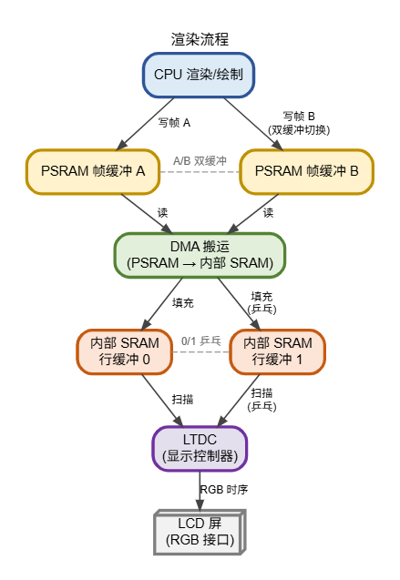

<table>
<colgroup>
<col style="width: 50%" />
<col style="width: 50%" />
</colgroup>
<thead>
<tr>
<th rowspan="2"></th>
<th>AN36002</th>
</tr>
<tr>
<th>V1.0</th>
</tr>
</thead>
<tbody>
</tbody>
</table>

说明

CH32V467 内置大容量 PSRAM，适用场景广泛。本文面向基于 CH32V467
进行图形界面开发的工程师，详细阐述了如何将 PSRAM 配置为 LTDC
显存以驱动高分辨率屏幕，并附带讲解了 LVGL 的移植方案。

**适用范围**

| 适用范围 | 系列     |
|----------|----------|
| 通用MCU  | CH32V467 |

目录

[说明 [1](#_Toc244791744)](#_Toc244791744)

[目录 [2](#_Toc244791745)](#_Toc244791745)

[表格索引 [2](#_Toc244791746)](#_Toc244791746)

[图片索引 [2](#_Toc244791747)](#_Toc244791747)

[第1章 方案概述 [1](#方案概述)](#方案概述)

[1.1 相关资源介绍 [1](#相关资源介绍)](#相关资源介绍)

[第2章 工程配置 [3](#_Toc244791750)](#_Toc244791750)

[2.1 配置链接脚本 [3](#配置链接脚本)](#配置链接脚本)

[2.2 PSRAM 与显存 [3](#psram-与显存)](#psram-与显存)

[2.2.1 PSRAM初始化 [3](#psram初始化)](#psram初始化)

[2.2.2 帧缓冲定义 [3](#帧缓冲定义)](#帧缓冲定义)

[2.3 LTDC 配置 [4](#ltdc-配置)](#ltdc-配置)

[2.3.1 像素时钟 [4](#像素时钟)](#像素时钟)

[2.3.2 屏幕的时序参数 [4](#屏幕的时序参数)](#屏幕的时序参数)

[2.3.3 图层配置 [5](#图层配置)](#图层配置)

[2.3.4 行缓冲乒乓配置 [5](#行缓冲乒乓配置)](#行缓冲乒乓配置)

[2.4 LVGL 配置 [7](#lvgl-配置)](#lvgl-配置)

[2.4.1 显示接口 [7](#显示接口)](#显示接口)

[2.4.2 时基 [8](#时基)](#时基)

[2.5 主函数 [9](#主函数)](#主函数)

[历史版本 [10](#_Toc244791764)](#_Toc244791764)

[声明 [11](#_Toc244791765)](#_Toc244791765)

表格索引

[MCU资源一览 [1](#_Toc244791189)](#_Toc244791189)

[时序参数表 [4](#_Toc244791190)](#_Toc244791190)

图片索引

[渲染流程示意图 [2](#_Toc244791188)](#_Toc244791188)

# 方案概述

## 相关资源介绍

CH32V467
内置大容量的PSRAM，根据封装不同，有4MiB和8MiB两种；起始地址0x80000000，8
位数据宽度，带独立 DMA。适合作为帧缓存。

| **项目**  | **参数**                                   |
|-----------|--------------------------------------------|
| 内核      | 青稞 RISC-V3V，SYSCLK 400MHz / HCLK 200MHz |
| Flash     | 512KB (可配置)                             |
| 内部 SRAM | 136KB/200KB (可配置)                       |
| PSRAM     | 4MB/8MB，8 位宽                            |
| LTDC      | 1 个图层，8×32 位 FIFO，支持多种像素格式   |

表 1‑1 MCU资源一览

LTDC 只有一个图层，FIFO 深度为 8×32 位。RGB565 下 32 字节只够 16
个像素，在 较高像素时钟下时间较短。如果让 LTDC 直接读 PSRAM，CPU
占用总线的时间稍长，FIFO 就会读空，屏幕上出现撕裂。因此本工程在内部 SRAM
中放两块行缓冲，隔一段时间由 PSRAM DMA 预取一次，LTDC 读的是行缓冲，不是
PSRAM。具体渲染流程如下。

<figure>

<figcaption>
图 1‑1 渲染流程示意图
</figcaption>
</figure>

# LTDC+LVGL项目移植 

## 配置链接脚本

PSRAM 按 4MB 使用。在 Ld/Link.ld 的 MEMORY 中增加 PSRAM 区，并在
SECTIONS 中增加 .psram 段：

    MEMORY
    {
        FLASH (rx)  : ORIGIN = 0x00000000,        LENGTH = 576K
        RAM   (xrw) : ORIGIN = 0x20000000 + 1024, LENGTH = 136K - 1K
        PSRAM (xrw) : ORIGIN = 0x80000000,        LENGTH = 4M
    }

    SECTIONS
    {
    	[…] /* 其余段保持原样 */
        .psram (NOLOAD) :
        {
            . = ALIGN(4);
            *(.psram.*)
            *(.psram*)
        } >PSRAM

        /* 其余段保持原样 */
    }

.psram 段必须带 NOLOAD。PSRAM
掉电后内容不保留，没有初值，并且需要复位后手动初始化PSRAM控制器。放在该段的变量用
\_\_attribute\_\_(( section(".psram"))) 声明。

## PSRAM 与显存

### PSRAM初始化

PSRAM 的初始化由官方 API 完成（PSRAM_INIT()），在 main()
开头调用一次即可，控制器时钟、时序、容量和读写时延都在函数内部配置。

容量按 4MB 使用，即 PSRAM_CAPCFG_32M，与链接脚本中的 LENGTH = 4M
对应。两块帧缓冲占 1.5MB，剩余空间可以根据需要使用。

### 帧缓冲定义

两块整屏帧缓冲的定义如下，两块缓冲共 1.5MB。

    #define LCD_W   800
    #define LCD_H   480

    __attribute__((aligned(32), section(".psram"))) static uint16_t LTDC_GRAM1[LCD_W * LCD_H];
    __attribute__((aligned(32), section(".psram"))) static uint16_t LTDC_GRAM2[LCD_W * LCD_H];

    const void *const LTDC_layer1 = LTDC_GRAM1;   
    const void *const LTDC_layer2 = LTDC_GRAM2;

## LTDC 配置

### 像素时钟

CH32V467 的LTDC像素时钟可以由ETH_PLL或者USB_PLL获得，本手册中使用ETH_PLL
分频得到，分频系数在 RCC-\>CFGR2 的 LTDCDIV\[5:0\] 中设置，实际分频数为
LTDCDIV+1。在这次的例程中，LTDCDIV
设置为15，实际分频为，16最后获得31.25MHz的时钟。

    RCC->CFGR2 &= ~(uint32_t)0x7F;   /* 清 LTDCSRC 与 LTDCDIV */
    ETH_PLL_CLK_Enable();            /* 使能 ETH_PLL，等待 ETHPLLRDY */
    RCC->CFGR2 |= (1 << 6);          /* 时钟源选 ETH_PLL（500MHz） */
    RCC->CFGR2 |= 15;                /* 16 分频，31.25MHz */

### 屏幕的时序参数

LTDC 的时序寄存器按"实际值减 1"写入，800×480
屏的取值见下表。按表中参数，每帧为 1081×545 个像素时钟，31.25MHz 下约
53fps。

表 2‑1 时序参数表

| **参数** | **手册值** | **写入值** | **计算**        |
|----------|-----------:|-----------:|-----------------|
| HSW      |          1 |          0 | HSW-1           |
| VSW      |          3 |          2 | VSW-1           |
| HBP      |         80 |         80 | HSW+HBP-1       |
| VBP      |         40 |         42 | VSW+VBP-1       |
| W        |        800 |        880 | HSW+HBP+W-1     |
| H        |        480 |        522 | VSW+VBP+H-1     |
| HFP      |        200 |       1080 | HSW+HBP+W+HFP-1 |
| VFP      |         22 |        544 | VSW+VBP+H+VFP-1 |

    LTDC_InitTypeDef s = {0};

    s.LTDC_HSPolarity = LTDC_HSPolarity_AH;
    s.LTDC_VSPolarity = LTDC_VSPolarity_AL;
    s.LTDC_DEPolarity = LTDC_DEPolarity_AH;
    s.LTDC_PCPolarity = LTDC_PCPolarity_IIPC;

    s.LTDC_HorizontalSync     = HSW - 1;
    s.LTDC_VerticalSync       = VSW - 1;
    s.LTDC_AccumulatedHBP     = HBP + HSW - 1;
    s.LTDC_AccumulatedVBP     = VBP + VSW - 1;
    s.LTDC_AccumulatedActiveW = LCD_W + HSW + HBP - 1;
    s.LTDC_AccumulatedActiveH = LCD_H + VSW + VBP - 1;
    s.LTDC_TotalWidth         = LCD_W + HSW + HBP + HFP - 1;
    s.LTDC_TotalHeigh         = LCD_H + VSW + VBP + VFP - 1;

    LTDC_Init(&s);

### 图层配置

屏幕的层设置如下：

    LTDC_Layer_InitTypeDef l = {0};

    l.LTDC_HorizontalStart = 0;
    l.LTDC_HorizontalStop  = LCD_W;
    l.LTDC_VerticalStart   = 0;
    l.LTDC_VerticalStop    = LCD_H;

    l.LTDC_PixelFormat     = LTDC_Pixelformat_RGB565;
    l.LTDC_CFBStartAdress  = (uint32_t)LTDC_GRAM1;       
    l.LTDC_CFBLineLength   = LCD_W * 2 + 31;             /* 行长加 31 */
    l.LTDC_CFBPitch        = LCD_W * 2;                  /* 行间距 */
    l.LTDC_CFBLineNumber   = LCD_H;

    LTDC_LayerInit(LTDC_Layer, &l);
    LTDC_LayerCmd(LTDC_Layer, ENABLE);
    LTDC_ReloadConfig(LTDC_IMReload);

### 行缓冲乒乓配置

行缓冲的切换在 LTDC
行中断里完成。每n行进一次中断，在这次示例，设置n=5；在行中断中，先把
CFBAR 指向已经填好的那块缓冲，再用 PSRAM DMA 把下一块 5
行搬到另一块缓冲。

    #define LAYER_BUF_CNT (5)

    __attribute__((aligned(32), section(".psram"))) static const uint16_t LTDC_GRAM1[layer1_w * layer1_h];
    __attribute__((aligned(32), section(".psram"))) static const uint16_t LTDC_GRAM2[layer1_w * layer1_h];

    const void* const LTDC_layer1 = LTDC_GRAM1;
    const void* const LTDC_layer2 = LTDC_GRAM2;

    __attribute__((aligned(32))) uint8_t* global_layer = (void*)LTDC_layer1;

    static volatile uint32_t buffer_switch = 0;
    static volatile uint32_t layer1_cnt    = 0; /* 该块在哪个缓冲 */

    __attribute__((aligned(32))) uint16_t layer1_buffer0[layer1_w * LAYER_BUF_CNT];
    __attribute__((aligned(32))) uint16_t layer1_buffer1[layer1_w * LAYER_BUF_CNT];

    static void LTDC_DMA_Change(uint32_t addr)
    {
        LTDC->IER |= (1 << 2);
        LTDC_Layer->CFBAR = (uint32_t)addr;

        LTDC_LIPConfig(layer1_cnt);

        LTDC_ReloadConfig(LTDC_IMReload);
        LTDC->IER &= ~(1 << 2);
    }

    void LTDC_IRQHandler(void)
    {
        LTDC_ClearITPendingBit(LTDC_IT_LI);

        uint16_t* layer16 = (void*)global_layer;

        if (buffer_switch)
        {
            buffer_switch = 0;

            LTDC_DMA_Change((uint32_t)layer1_buffer1);

            void*    dst = layer1_buffer0;
            void*    src = &(layer16[layer1_cnt * layer1_w]);
            uint32_t len = layer1_w * LAYER_BUF_CNT * layer1_pixel_size;

            PSRAMDMARead((void*)dst, (uint32_t)src, len / 4, PSRAM_DMA_SIZE_32, DMA_BRST_NUM2, DMA_PAUSE_TIM0);
        }
        else
        {
            buffer_switch = 1;

            LTDC_DMA_Change((uint32_t)layer1_buffer0);

            void*    dst = layer1_buffer1;
            void*    src = &(layer16[layer1_cnt * layer1_w]);
            uint32_t len = layer1_w * LAYER_BUF_CNT * layer1_pixel_size;

            PSRAMDMARead(dst, (uint32_t)src, len / 4, PSRAM_DMA_SIZE_32, DMA_BRST_NUM2, DMA_PAUSE_TIM0);
        }

        layer1_cnt += LAYER_BUF_CNT;
        layer1_cnt %= layer1_h;
        if (layer1_cnt == 0)
        {

            void ltdc_flushed();
            ltdc_flushed();
        }
    }

## LVGL 配置

把 lvgl-8.3.11 整个目录加入工程，参与编译的文件包括 src
下的内核、lv_conf.h、lv_port_disp.c、lv_port_indev.c，以及
lv_demo_widgets 及其图片资源。

### 显示接口

显示部分使用整屏双缓冲，并把 full_refresh 置 1。这样 LVGL 每次交给
flush_cb 的都是完整的一帧，回调里不需要搬运数据，只记录缓冲地址。

flush_cb 里不调用 lv_disp_flush_ready，等一帧扫描结束、调用 ltdc_flushed
时再放行。这样 LVGL 的出帧速度不会超过屏幕刷新率。

    void lv_port_disp_init(void)
    {
        extern const void *LTDC_layer1;
        extern const void *LTDC_layer2;

        lv_disp_draw_buf_init(&draw_buf,
                              (lv_color_t *)LTDC_layer1,   /* PSRAM 整屏 */
                              (lv_color_t *)LTDC_layer2,
                              800 * 480);

        lv_disp_drv_init(&disp_drv);
        disp_drv.hor_res      = 800;
        disp_drv.ver_res      = 480;
        disp_drv.flush_cb     = disp_flush;
        disp_drv.draw_buf     = &draw_buf;
        disp_drv.full_refresh = 1;
        lv_disp_drv_register(&disp_drv);
    }

    static void disp_flush(lv_disp_drv_t* disp_drv, const lv_area_t* area, lv_color_t* color_p)
    {
        if (disp_flush_enabled)
        {
            global_layer = (void*)color_p; /* 只登记缓冲地址 */
        }
    }

    void ltdc_flushed() 
    {
        lv_disp_flush_ready(&disp_drv);
    }

### 时基

LVGL 的 tick 由 TIM4 提供，在中断中更新。

    void TIM4_init(void)
    {
        TIM_TimeBaseInitTypeDef t = {0};

        RCC_PB1PeriphClockCmd(RCC_PB1Periph_TIM4, ENABLE);
        t.TIM_Prescaler     = SystemCoreClock / 100000;
        t.TIM_Period        = 500;
        t.TIM_ClockDivision = TIM_CKD_DIV1;
        t.TIM_CounterMode   = TIM_CounterMode_Up;
        TIM_TimeBaseInit(TIM4, &t);

        TIM_ClearFlag(TIM4, TIM_FLAG_Update);
        TIM_ITConfig(TIM4, TIM_IT_Update, ENABLE);
        NVIC_EnableIRQ(TIM4_IRQn);
        TIM_Cmd(TIM4, ENABLE);
    }

    void TIM4_IRQHandler(void)
    {
        TIM_ClearITPendingBit(TIM4, TIM_IT_Update);
        lv_tick_inc(5);
    }

## 主函数

至此LTDC+LVGL的显示组合基本已经移植完成，在主函数中加入lv_task_handler
就会开始绘制。

        lv_init();
        lv_port_disp_init();
        lv_port_indev_init();
        lv_demo_widgets();

        while (1)
        {
            lv_task_handler();
        }

历史版本

| 日期      | 版本 | 变更内容 |
|-----------|------|----------|
| 2026/11/6 | V1.0 | 初版发行 |

声明

本手册仅供参考。作者在不另行通知的情况下，可随时进行修改。
