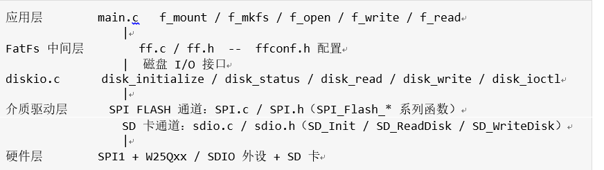
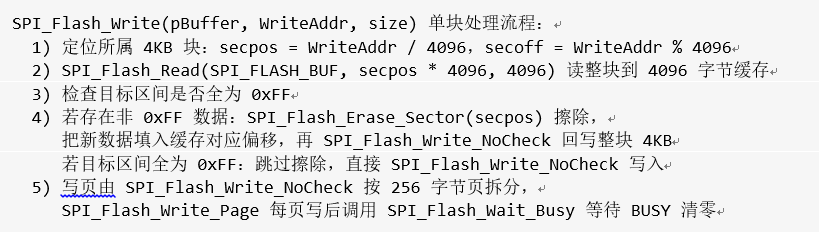

<table>
<colgroup>
<col style="width: 49%" />
<col style="width: 50%" />
</colgroup>
<thead>
<tr>
<th rowspan="2"></th>
<th>AN90003</th>
</tr>
<tr>
<th>V1.0</th>
</tr>
</thead>
<tbody>
</tbody>
</table>

说明

本应用笔记说明如何在 MounRiver Studio 的 CH32V 系列（RISC-V，标准外设库
SPL）工程中移植 FatFs 文件系统。按存储介质分为两大类：SPI FLASH 与 SDIO
接口控制的 SD 卡，两者共用同一套 FatFs 中间层，差异集中在介质驱动与
diskio.c 适配。

文中所有接口名、宏名、引脚定义与命令码均取自模板代码库中的实际例程（SPI
Flash 驱动、SDIO 例程与 FatFs 例程），可直接对照落地，未作推测性描述。

阅读本文需要具备 C 语言与 CH32V 标准外设库的使用基础。移植过程中请勿修改
FatFs 本体文件 ff.c，所有适配工作集中在 diskio.c 与 ffconf.h。

**适用范围**

| 适用范围 | 系列                          |
|----------|-------------------------------|
| 通用MCU  | CH32V407 等带 SDIO /SPI的型号 |

目录

[说明 [1](#_Toc244868524)](#_Toc244868524)

[目录 [2](#_Toc244868525)](#_Toc244868525)

[表格索引 [2](#_Toc244868526)](#_Toc244868526)

[图片索引 [2](#_Toc244868527)](#_Toc244868527)

[第1章 概述 [1](#概述)](#概述)

[1.1 移植目标与总体思路 [1](#移植目标与总体思路)](#移植目标与总体思路)

[1.1.1 分层结构 [1](#分层结构)](#分层结构)

[1.1.2 工程文件构成 [1](#工程文件构成)](#工程文件构成)

[第2章 SPI FLASH 文件系统移植
[2](#spi-flash-文件系统移植)](#spi-flash-文件系统移植)

[2.1 硬件与接口配置 [2](#硬件与接口配置)](#硬件与接口配置)

[2.1.1 SPI 引脚连接 [2](#spi-引脚连接)](#spi-引脚连接)

[2.2 扇区尺寸与地址偏移 [2](#扇区尺寸与地址偏移)](#扇区尺寸与地址偏移)

[2.2.1 4KB 扇区与读-改-写 [2](#kb-扇区与读-改-写)](#kb-扇区与读-改-写)

[2.2.2 偏移 1536 扇区与可用容量
[3](#偏移-1536-扇区与可用容量)](#偏移-1536-扇区与可用容量)

[2.3 diskio 适配 [3](#diskio-适配)](#diskio-适配)

[2.4 挂载与读写示例 [4](#挂载与读写示例)](#挂载与读写示例)

[第3章 SDIO 接口 SD 卡文件系统移植
[6](#sdio-接口-sd-卡文件系统移植)](#sdio-接口-sd-卡文件系统移植)

[3.1 硬件与接口配置 [6](#硬件与接口配置-1)](#硬件与接口配置-1)

[3.1.1 SDIO 引脚连接 [6](#sdio-引脚连接)](#sdio-引脚连接)

[3.1.2 时钟与驱动接口 [6](#时钟与驱动接口)](#时钟与驱动接口)

[3.2 diskio 适配 [6](#diskio-适配-1)](#diskio-适配-1)

[3.3 挂载与读写示例 [7](#挂载与读写示例-1)](#挂载与读写示例-1)

[第4章 配置与验证 [8](#配置与验证)](#配置与验证)

[4.1 ffconf.h 关键配置 [8](#ffconf.h-关键配置)](#ffconf.h-关键配置)

[4.2 两通道差异对照 [8](#两通道差异对照)](#两通道差异对照)

[4.3 常见问题排查 [9](#常见问题排查)](#常见问题排查)

[4.4 验证步骤 [9](#验证步骤)](#验证步骤)

[历史版本 [10](#_Toc244868551)](#_Toc244868551)

[声明 [11](#_Toc244868552)](#_Toc244868552)

表格索引

[文件构成 [1](#_Toc244868553)](#_Toc244868553)

[引脚连接 [2](#_Toc244868554)](#_Toc244868554)

[SDIO 引脚连接 [6](#_Toc244868555)](#_Toc244868555)

[配置与差异 [8](#_Toc244868556)](#_Toc244868556)

[通道差异 [8](#_Toc244868557)](#_Toc244868557)

[问题与排查 [9](#_Toc244868558)](#_Toc244868558)

图片索引

[分层关系 [1](#_Toc244868559)](#_Toc244868559)

[处理流程 [3](#_Toc244868560)](#_Toc244868560)

# 概述

本章介绍 FatFs 在 CH32V
工程中的分层结构与工程文件构成，为后续介质适配提供基础。

## 移植目标与总体思路

移植目标是让应用层能够通过标准 FatFs
接口（f_mount、f_open、f_read、f_write
等）访问存储介质，而介质差异被隔离在 diskio.c 一层。FatFs
属于中间层，向上提供文件 API，向下通过固定的磁盘 I/O 接口调用介质驱动

### 分层结构

FatFs 的分层关系如图 1-1 所示。两个工程的差异只出现在介质驱动层与
diskio.c 的物理驱动器号、扇区参数上，FatFs 本体完全一致。

<figure>

<figcaption>
图 1‑1分层关系
</figcaption>
</figure>

### 工程文件构成

两个工程的文件构成如表 1-1 所示。需要注意的是，FATFS 目录在 SPI FLASH
工程中位于工程根目录，在 SDIO 工程中位于 User
目录下，加入工程时按实际路径添加头文件搜索路径即可。

<table>
<caption>
表 1‑1文件构成
</caption>
<colgroup>
<col style="width: 22%" />
<col style="width: 26%" />
<col style="width: 50%" />
</colgroup>
<thead>
<tr>
<th><strong>工程</strong></th>
<th><strong>目录</strong></th>
<th><strong>文件</strong></th>
</tr>
</thead>
<tbody>
<tr>
<td rowspan="2">FATFS_SPI_FLASH</td>
<td>FATFS/</td>
<td>diskio.c、diskio.h、ff.c、ff.h、ffconf.h、ffsystem.c、ffunicode.c</td>
</tr>
<tr>
<td>User/</td>
<td>main.c、SPI.c、SPI.h、ch32v4x7_conf.h、ch32v4x7_it.c/h、system_ch32v4x7.c/h</td>
</tr>
<tr>
<td rowspan="2">FATFS_SDIO_SD</td>
<td>User/FATFS/</td>
<td>diskio.c、diskio.h、ff.c、ff.h、ffconf.h、ffsystem.c、ffunicode.c</td>
</tr>
<tr>
<td>User/</td>
<td>main.c、sdio.c、sdio.h、ch32v4x7_conf.h、ch32v4x7_it.c/h、system_ch32v4x7.c/h</td>
</tr>
</tbody>
</table>

# SPI FLASH 文件系统移植

本章基于 FATFS_SPI_FLASH 工程，说明以 W25Qxx 为介质的文件系统移植方法。

## 硬件与接口配置

### SPI 引脚连接

SPI FLASH 通过 SPI1 连接，引脚连接如表 2-1 所示。片选 CS 由 GPIO
直接控制，不占用硬件 NSS。

| **信号**  | **引脚**         | **说明**               |
|-----------|------------------|------------------------|
| CS        | PA2              | 普通推挽输出，空闲为高 |
| CLK       | PA5（SPI1_SCK）  | 复用推挽输出           |
| DO        | PA6（SPI1_MISO） | 浮空输入               |
| DI        | PA7（SPI1_MOSI） | 复用推挽输出           |
| WP / HOLD | 3.3V             | 直接拉高               |

表 2‑1引脚连接

SPI 初始化在 SPI_Flash_Init() 中完成：使能 RCC_PB2Periph_GPIOA
与RCC_PB2Periph_SPI1；SPI 工作于主机模式、双线全双工、8
位数据、CPOL_High 与 CPHA_2Edge、软件 NSS、预分频
SPI_BaudRatePrescaler_4、MSB 先行。片选由 GPIO_WriteBit(GPIOA,
GPIO_Pin_2, 0/1) 控制。

## 扇区尺寸与地址偏移

### 4KB 扇区与读-改-写

与 SD 卡不同，该工程把 FatFs 的逻辑扇区尺寸设为 4096 字节，与 SPI FLASH
的擦除粒度一致，即 FF_MIN_SS 为 512、FF_MAX_SS 为 4096。这样一次
disk_write 对应的写入长度就是 4KB 的整数倍，避免跨擦除块的读-改-写。

单块内部的擦除仍不可避免：SPI FLASH 只能把 1 写为
0，写前必须擦除。SPI_Flash_Write() 已内置处理，流程如图 2-1 所示

<figure>

<figcaption>
图 2‑1处理流程
</figcaption>
</figure>

因此 disk_write 中直接调用 SPI_Flash_Write 即可，无需在 diskio.c
中再实现缓存与擦除逻辑。工程中该缓存为全局数组
SPI_FLASH_BUF\[4096\]，会占用 4KB RAM

### 偏移 1536 扇区与可用容量

该工程的 diskio.c 在读写前统一执行 sector +=
1536，即把逻辑扇区号整体后移 1536 个 4KB 扇区（6MB）。这样文件系统占用
6MB 之后的区域，前 6MB
留给其他用途（如程序、参数区或另一份数据），避免与既有数据冲突。

配合 disk_ioctl 的返回值，文件系统的实际参数为：GET_SECTOR_COUNT 为
2560、GET_SECTOR_SIZE 为 4096、GET_BLOCK_SIZE 为 1。因此文件系统容量为
2560 × 4KB = 10MB，占用范围为 6MB 至 16MB，正好对应 16MB 的
W25Q128。若要改到其他容量的器件，需要同步修改偏移量与扇区总数两个参数。

## diskio 适配

该工程的物理驱动器号定义为 SPI_FLASH = 0，因此挂载路径使用
"0:"。五个接口的实现要点如下：

    #define SPI_FLASH     0    /* SPI FLASH 映射到物理驱动器 0 */
       
    DSTATUS disk_status (BYTE pdrv)
    {
        switch (pdrv) {
        case SPI_FLASH :
            id = SPI_Flash_ReadID();       /* 0xEF13 ~ 0xEF17 命中则清除 STA_NOINIT */
            ...
        }
    }

    DRESULT disk_read (BYTE pdrv, BYTE *buff, LBA_t sector, UINT count)
    {
        case SPI_FLASH :
            sector += 1536;
            SPI_Flash_Read(buff, sector << 12, count << 12);
            res = RES_OK;
    }

    DRESULT disk_write (BYTE pdrv, const BYTE *buff, LBA_t sector, UINT count)
    {
        case SPI_FLASH :
            sector += 1536;
            write_addr = sector << 12;
            SPI_Flash_Write((u8 *)buff, write_addr, count << 12);
            res = RES_OK;
    }

    DRESULT disk_ioctl (BYTE pdrv, BYTE cmd, void *buff)
    {
        case SPI_FLASH :
            case CTRL_SYNC:        break;
            case GET_SECTOR_COUNT: *(DWORD*)buff = 2560;   break;
            case GET_SECTOR_SIZE:  *(WORD*)buff  = 4096;   break;
            case GET_BLOCK_SIZE:   *(WORD*)buff  = 1;      break;
            case CTRL_TRIM:        break;
    } 

注意：SPI_Flash_Read 与 SPI_Flash_Write 的长度参数类型为 u16，而
disk_read/disk_write 传入的是 count \<\<
12，单次调用可覆盖的扇区数上限约为 15 个（15 × 4096 = 61440，16 × 4096
会溢出 16 位）。若应用中存在大块连续读写，建议把驱动接口的长度参数改为
u32，或在 diskio.c 内按 15 个扇区分段循环调用。

## 挂载与读写示例

主流程为：初始化 SPI 与
Flash、识别型号、挂载、无文件系统时格式化、建文件、写入、读回。关键代码如下：

    SPI_Flash_Init();
    Flash_Model = SPI_Flash_ReadID();      /* 打印型号，失败则打印 Fail! */
    SPI_Flash_Erase_Sector(0);

    opt.fmt = FM_FAT;  opt.n_fat = 1;  opt.align = 0;  opt.au_size = 0;

    res_sd = f_mount(&fs, "0:", 1);
    if (res_sd == FR_NO_FILESYSTEM) {
        res_sd = f_mkfs("0:", &opt, work, sizeof(work));
        if (res_sd == FR_OK) { res_sd = f_mount(&fs, "0:", 1); }
    }

    res_sd = f_open(&fnew, "0:/testWCH.txt", FA_CREATE_ALWAYS | FA_WRITE);
    res_sd = f_write(&fnew, WriteBuf, 11, &fnum);
    f_close(&fnew);

    res_sd = f_open(&fnew, "0:/testWCH.txt", FA_OPEN_EXISTING | FA_READ);
    res_sd = f_read(&fnew, ReadSDBuf, 11, (UINT *)&fnum);

工程中 WriteBuf 为 "Hello WCH!"（11
字节），读回后逐字节打印比对。格式化参数使用 FM_FAT，work 缓冲区大小为
FF_MAX_SS（该工程为 4096）。

# SDIO 接口 SD 卡文件系统移植

本章基于 FATFS_SDIO_SD 工程，说明通过 SDIO 外设控制 SD 卡的移植方法。

## 硬件与接口配置

### SDIO 引脚连接

SD 卡通过 SDIO 外设连接，引脚连接如表 3-1 所示，采用 4 位宽数据总线。

| **信号** | **引脚** | **说明**  |
|----------|----------|-----------|
| CLK      | PC12     | SDIO 时钟 |
| CMD      | PD2      | 命令线    |
| D0       | PB14     | 数据线 0  |
| D1       | PB15     | 数据线 1  |
| D2       | PC10     | 数据线 2  |
| D3       | PC11     | 数据线 3  |

表 3‑1 SDIO 引脚连接

### 时钟与驱动接口

时钟分频与工作模式在 sdio.h 中定义：SDIO_INIT_CLK_DIV 为
0xB2，用于初始化阶段的慢速时钟；SDIO_TRANSFER_CLK_DIV 为
0x00，用于传输阶段；工作模式可选 SD_POLLING_MODE 或
SD_DMA_MODE。驱动对外接口包括
SD_Init、SD_GetState、SD_GetCardInfo、SD_ReadDisk、SD_WriteDisk，以及全局变量
SDCardInfo（含 CardType、CardCapacity、CardBlockSize、RCA、SD_cid
等成员）。

## diskio 适配

该工程沿用 FatFs 示例的驱动器号约定：DEV_RAM 为 0、DEV_MMC 为 1、DEV_USB
为 2，SD 卡使用 DEV_MMC，因此挂载路径写作 "1:"。各接口实现要点如下：

    #define DEV_MMC     1   /* SD 卡映射到物理驱动器 1 */

    DSTATUS disk_status (BYTE pdrv)
    {
        case DEV_MMC :
            result = SD_GetState();
            if (result < SD_CARD_DISCONNECTED) { stat &= ~STA_NOINIT; }
            else                               { stat  = STA_NOINIT;  }
    }

    DRESULT disk_read (...)
    {
        case DEV_MMC :
            result = SD_ReadDisk(buff, sector, count);      /* SD_OK 映射为 RES_OK */
    }

    DRESULT disk_write (...)
    {
        case DEV_MMC :
            result = SD_WriteDisk((u8 *)buff, sector, count);
    }

disk_ioctl 的参数取自卡信息结构体：

    case GET_SECTOR_COUNT: *(DWORD*)buff = SDCardInfo.CardCapacity / 512;  break;
    case GET_SECTOR_SIZE:  *(WORD*)buff  = SDCardInfo.CardBlockSize;       break;
    case GET_BLOCK_SIZE:   *(WORD*)buff  = SDCardInfo.CardBlockSize;       break;

get_fattime() 在工程中固定返回 0。注意：SD_ReadDisk 与 SD_WriteDisk
的扇区计数参数类型为 u8，而 disk_read/disk_write 传入的是 UINT
count，单次请求超过 255
个扇区时会被截断，大块连续读写时建议将驱动接口参数改为 u32 并在 diskio.c
内分段处理。

## 挂载与读写示例

主流程与 SPI FLASH 通道一致，差别在于驱动器号与格式化格式：

    while (SD_Init()) { printf("SD Card Error!\r\n"); delay_ms(1000); }
    show_sdcard_info();                    /* 打印卡类型、ManufacturerID、RCA、容量、块大小 */

    opt.fmt = FM_FAT32;  opt.n_fat = 1;  opt.align = 0;  opt.au_size = 0;

    res_sd = f_mount(&fs, "1:", 1);
    if (res_sd == FR_NO_FILESYSTEM) {
        res_sd = f_mkfs("1:", &opt, work, sizeof(work));
        if (res_sd == FR_OK) { res_sd = f_mount(&fs, "1:", 1); }
    }

    res_sd = f_open(&fnew, "1:/testWCH.txt", FA_CREATE_ALWAYS | FA_WRITE);
    res_sd = f_write(&fnew, WriteBuf, 11, &fnum);
    f_close(&fnew);

    res_sd = f_open(&fnew, "1:/testWCH.txt", FA_OPEN_EXISTING | FA_READ);
    res_sd = f_read(&fnew, ReadSDBuf, 11, (UINT *)&fnum);

该工程的格式化格式为 FM_FAT32，与 SPI FLASH 工程的 FM_FAT 不同；work
缓冲区大小为 FF_MAX_SS（该工程为 512）。SD_Init 失败时会循环打印 "SD
Card Error!" 并延时 1 秒重试。

# 配置与验证

## ffconf.h 关键配置

两个工程的 ffconf.h 主要配置与差异如表 4-1 所示。

| **配置项** | **FATFS_SPI_FLASH** | **FATFS_SDIO_SD** | **说明** |
|----|----|----|----|
| FF_MIN_SS | 512 | 512 | 最小扇区尺寸 |
| FF_MAX_SS | 4096 | 512 | SPI FLASH 侧取 4096 以对齐擦除粒度 |
| FF_VOLUMES | 1 | 3 | 逻辑卷数量，与驱动器号约定相关 |
| FF_USE_FASTSEEK | 1 | 0 | SPI FLASH 侧开启快速定位 |
| FF_USE_MKFS | 1 | 1 | 使能 f_mkfs() |
| FF_CODE_PAGE | 936 | 936 | 简体中文代码页 |

表 4‑1配置与差异

## 两通道差异对照

两个通道的主要差异汇总于表。

| **项目**      | **SPI FLASH 通道**                | **SD 卡通道（SDIO）**      |
|---------------|-----------------------------------|----------------------------|
| 物理驱动器号  | SPI_FLASH = 0，路径 "0:"          | DEV_MMC = 1，路径 "1:"     |
| 逻辑扇区尺寸  | 4096                              | 512（取自 CardBlockSize）  |
| 扇区总数      | 2560（固定值）                    | CardCapacity / 512（动态） |
| 地址偏移      | 读写前整体 +1536 扇区（6MB）      | 无偏移                     |
| 格式化格式    | FM_FAT                            | FM_FAT32                   |
| 写前擦除      | 需要，由 SPI_Flash_Write 内置处理 | 不需要                     |
| 附加 RAM 开销 | SPI_FLASH_BUF\[4096\] 共 4KB      | 无                         |

表 4‑2通道差异

## 常见问题排查

常见异常现象及原因：

| **现象** | **可能原因** |
|----|----|
| SPI FLASH 打印 Fail! | ID 不在 0xEF13~0xEF17 范围内，或接线（CS/CLK/DI/DO）异常 |
| FR_NOT_READY（SPI FLASH） | disk_status 未识别到器件，或 SPI 初始化未执行 |
| FR_NOT_READY（SD 卡） | 卡未插好、引脚连接或上拉不符，或 SD_Init() 未成功 |
| FR_NO_FILESYSTEM | 介质未格式化；FF_USE_MKFS 为 0 时无法就地格式化 |
| FR_DISK_ERR（SPI FLASH 写） | 目标区域未擦除、跨页写入未拆分，或写后未等待 BUSY 清零 |
| 容量与预期不符 | SPI FLASH 的扇区总数 2560 与偏移 1536 为固定值，需按实际器件调整 |
| 大块读写异常 | 驱动接口长度参数为 u16，单次请求扇区过多导致长度溢出 |
| 中文或长文件名无法打开 | FF_CODE_PAGE 不是 936，或 FF_USE_LFN 为 0 且未加入 ffunicode.c |

表 4‑3问题与排查

## 验证步骤

建议按以下顺序验证：先经串口（115200，调用
USART_Printf_Init(115200)）确认 SystemClk 与 ChipID
输出正常；再确认介质识别成功——SPI FLASH 侧打印 SPI_Flash_ReadID()
得到的型号，SD 卡侧调用 show_sdcard_info()
打印卡类型、ManufacturerID、RCA、容量与块大小；随后确认 f_mount 返回
FR_OK，若返回 FR_NO_FILESYSTEM 则确认 f_mkfs 成功并重新挂载；最后确认
f_open、f_write、f_close、f_open、f_read 的返回值均为 FR_OK，且读回的 11
字节数据与写入内容一致。

历史版本

| 日期       | 版本 | 变更内容 |
|------------|------|----------|
| 2026/10/19 | V1.0 | 初版发行 |

声明

本手册仅供参考。作者在不另行通知的情况下，可随时进行修改。
