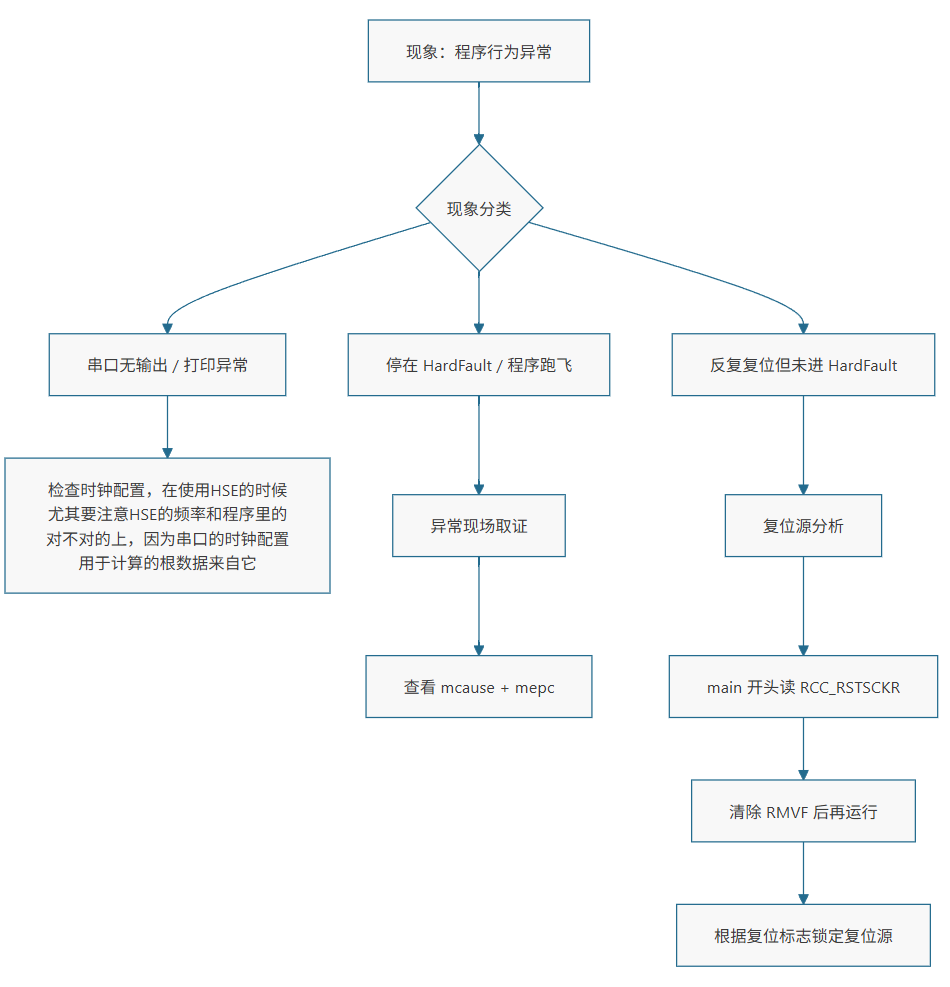

<table>
<colgroup>
<col style="width: 49%" />
<col style="width: 50%" />
</colgroup>
<thead>
<tr>
<th rowspan="2"></th>
<th>AN91006</th>
</tr>
<tr>
<th>V1.0</th>
</tr>
</thead>
<tbody>
</tbody>
</table>

说明

本应用笔记面向一线嵌入式工程师，围绕 CH32
调试功能的实际使用，提供一套“先取证、再定位、后修复”的排障方法。文档不追求罗列所有调试技巧，而是把常见异常现象映射到可执行的调试动作：断点停在哪里、看哪个寄存器、如何对照
map/反汇编、如何判断复位源、调试器连不上时先做什么。具体案例由后续章节按统一模板展开，本文负责给出背景、准备事项和速查框架。

**适用范围**

| 适用范围 | 系列        |
|----------|-------------|
| 通用MCU  | 通用MCU系列 |

目录

[说明 [1](#_Toc244868086)](#_Toc244868086)

[目录 [2](#_Toc244868087)](#_Toc244868087)

[表格索引 [2](#_Toc244868088)](#_Toc244868088)

[图片索引 [2](#_Toc244868089)](#_Toc244868089)

[第1章 调试前的三项基础准备
[1](#调试前的三项基础准备)](#调试前的三项基础准备)

[1.1 通用排障 [1](#通用排障)](#通用排障)

[第2章 典型案例 [2](#典型案例)](#典型案例)

[2.1 volatile： [2](#volatile)](#volatile)

[2.2 Sizeof [3](#sizeof)](#sizeof)

[2.3 返回局部数组地址 [4](#返回局部数组地址)](#返回局部数组地址)

[2.4 调试常见问题 [6](#调试常见问题)](#调试常见问题)

[2.4.1 优化后行号映射变粗 [6](#优化后行号映射变粗)](#优化后行号映射变粗)

[2.4.2 HardFault_Handler自带复位
[6](#hardfault_handler自带复位)](#hardfault_handler自带复位)

[历史版本 [7](#_Toc244868099)](#_Toc244868099)

[声明 [8](#_Toc244868100)](#_Toc244868100)

图片索引

[常见问题排查线路 [1](#_Toc244868101)](#_Toc244868101)

### 调试前的三项基础准备

调试接口选择正确。在 MounRiver Studio
的调试配置中选择错误接口，典型表现为连接失败或无法设置断点。

调试期间关闭干扰源。 仿真时建议关闭看门狗、低功耗模式和与断点冲突的
Flash
读写操作。看门狗可能在断点处超时复位；低功耗可能切断调试接口时钟。调试模块通常也支持
CPU 暂停时冻结看门狗计数。

## 通用排障

1.  **先读寄存器，再改代码。** CH32V 的 mcause/mepc，RCC_RSTSCKR
    的复位源标志，都是芯片直接提供的“现场证据”。先把这些值读出来，再对照
    map 文件或反汇编定位到源码行，比在工程里盲目加打印更可靠。

2.  **区分“调试态”与“运行态”。**
    断点暂停会改变时序，看门狗、低功耗、Flash
    操作在调试态下的行为可能与全速运行不同。定位问题时，应结合“暂停观察”和“全速复现”两种手段交叉验证。

<figure>

<figcaption>
图 1‑1 常见问题排查线路
</figcaption>
</figure>

# 典型案例

## volatile：

**现象**

程序卡在while里，g_stage停在
40，永远到不了41。但用调试器一看，等待的标志**早就是1了**。

**典型错误**

    uint32_t g_irq_flag = 0;              /* 被中断修改，但没有 volatile */

    void TIM2_IRQHandler(void)            /* TIM2 每 100ms 置一次标志 */
    {
        if(TIM_GetITStatus(TIM2, TIM_IT_Update) != RESET)
        {
            TIM_ClearITPendingBit(TIM2, TIM_IT_Update);
            g_irq_flag = 1;
        }
    }

    static void scenario_volatile(void)
    {
        demo_tim2_init();
        g_stage = 40;

        while(g_irq_flag == 0)            /* 优化后只读一次内存 */
        {
        }

        g_stage = 41;
    }

**排查流程**

1)  先在while那一行下断点，确认程序确实进了循环、g_irq_flag初始是 0；

2)  再在中断服务函数里下断点，确认**中断确实在跑**；

3)  然后让程序自由运行一会儿，暂停，同时读 PC和g_irq_flag；

4)  如果内存里是 1、PC
    却还在循环里"，基本可以断定是编译器把读操作优化掉了；

5)  最后用反汇编确认，形成闭环。

**实操**

中断确实在跑（断点停在PC=0x2da \<TIM2_IRQHandler\>），中断里执行过
g_irq_flag = 1。

让程序继续跑后暂停：

    PC        = 0x34c <DebugDemo_Run+86>   // 原地自跳转
    g_irq_flag = 1                          // 内存里已经是 1
    g_stage    = 40                         // 永远到不了 41

反汇编把原因写得很清楚：

         344: sw   a4,0(a5)          ; g_stage = 40
         346: lw   a4,-2024(gp)      ; 读 g_irq_flag —— 整个循环只读这一次
         34a: bnez a4,34e            ; 非 0 才跳出去
         34c: j    34c               ; 为 0 就原地死等，再也不读内存

**问题原因**

g_irq_flag不是volatile，编译器认为"这段循环里没有任何东西能改它"（空循环、没有函数调用、没有内存屏障），于是把唯一一次lw提到循环外，
循环退化成j self。

调试器读的是内存，所以看到的是
1；CPU用的是寄存器里缓存的旧值0。"调试器看到的值"和"程序实际用的值"不一致，正是这类问题的典型特征。

**修复方法**

修改变量声明为volatile uint32_t g_irq_flag = 0;

凡是会被 中断/其它线程/DMA/硬件修改、又被主流程轮询的变量，都必须
volatile。

## sizeof

**现象**

memcpy 之后数据"只对了一半"，后 4 个字节原封不动。

**典型错误**

    uint8_t g_cpy_src[8] = { 1, 2, 3, 4, 5, 6, 7, 8 };
    uint8_t g_cpy_dst[8] = { 0xEE, 0xEE, 0xEE, 0xEE, 0xEE, 0xEE, 0xEE, 0xEE };

    static void scenario_sizeof_ptr(void)
    {
        uint8_t *p = g_cpy_src;

        g_stage = 70;

        /* 本意是拷 8 字节，实际 sizeof(uint8_t *) == 4 */
        memcpy(g_cpy_dst, p, sizeof(p));

        g_stage = 71;
    }

**排查流程**

1)  在memcpy之后下断点，读源和目标的原始内存（不要只读"变量名"，数组/被优化过的变量经常显示
    \`\<optimized out\>\`）；

2)  对比两份内存，看"从第几个字节开始不一致"；

3)  反汇编看这次拷贝到底搬了几字节。

**实操**

源和目标的实际内存（g_cpy_dst @ 0x20000080，g_cpy_src @ 0x20000088）：

    g_cpy_src = [1, 2, 3, 4, 5, 6, 7, 8]
    g_cpy_dst = [1, 2, 3, 4, 238, 238, 238, 238]     // 238 = 0xEE，初始值

后 4 个字节完全没被写。反汇编把原因写死了：

    2e8: lw a3,-2040(gp)      ; 一次读 4 字节
    2f4: sw a3,128(a4)        ; 一次写 4 字节

**问题原因**

p 是 uint8_t \*，在 RV32 上 sizeof(p) == 4。 sizeof(数组名)
才是数组长度，sizeof(指针) 永远是指针宽度。

修复方法

    memcpy(dst, src, sizeof(g_cpy_src));              /* 用真正的数组名 */
    memcpy(dst, src, sizeof(g_cpy_src[0]) * 8);       /* 或元素大小 * 个数 */
    #define ARRAY_SIZE(a) (sizeof(a) / sizeof((a)[0]))

## 返回局部数组地址

**现象**

函数"正常返回"，程序也没崩，但读到的数据是一个完全无关的值：观测点g_stage=193，而按设计应该是
83（82+buf\[0\]，buf\[0\]预期是1）。

错误原因

    static __attribute__((noinline)) uint8_t *demo_get_buffer(void)
    {
        uint8_t buf[8];

        for(uint8_t i = 0; i < 8; i++)
        {
            buf[i] = i + 1;
        }

        return buf;                 /* 返回的是栈地址，函数一返回就失效 */
    }

    static void scenario_return_stack(void)
    {
        uint8_t *p = demo_get_buffer();

        g_buf_addr = (uint32_t)p;
        g_stage = 80;

        demo_clobber_stack();       /* 用相近的栈深度把刚才那块位置覆盖掉 */
        g_stage = 81;

        g_stage = 82 + p[0];        /* 观测点 */
    }

**排查流程**

1)  断点读"记录下来的地址g_buf_addr —— 结果是 0，不是栈地址；

2)  反汇编 demo_get_buffer，看编译器到底生成了什么；

3)  回头检查编译输出里的告警。

**实操**

    g_buf_addr = 0
    g_stage    = 193
    mem[0x00000000] = 111

82+111=193，完全对得上 —— 说明p\[0\]读的是地址 0 处的字节，

不是原来的buf\[0\]。

反汇编：

    000002da <demo_get_buffer>:
         2da: li  a0,0        ; 直接返回 0
         2dc: ret

整个函数只剩两条指令：数组、循环、赋值全部消失。

而编译告警其实早就说了：

    -Wreturn-local-addr: function returns address of local variable   debug_demo.c:215

**问题原因**

"返回局部变量（数组）的地址"在 C
里是未定义行为：函数返回后栈帧失效，地址不再有效。GCC 8.2
在-Os下直接把这种"不可能正确"的返回值折叠成
0，顺手把不会被观察到的buf和循环一起删掉。

补充：如果编译器保留了栈地址

换优化等级或编译器时，它也可能真的返回栈地址。那时的现象是另一副样子：

g_buf_addr 指向
0x20007xxx（栈区）；断点处读它，内容还是1,2,3,...,8；继续执行、再调用几层函数后，同一地址的内容被后来的局部变量覆盖；表现就是"指针没变、内容自己变了"，非常像野指针，但地址完全合法。

**修复方法**

需要"函数内产生、函数外使用"的缓冲区，就让调用者传入；或者放 static /
全局；需要动态生命周期就用malloc（注意堆与栈相撞）；永远不要返回局部变量/局部数组的地址。

## 调试常见问题

### 优化后行号映射变粗

-Os
下，简单的静态函数会被内联，循环体内的行号可能全部映射到函数入口，于是"在
count++上打断点"实际停在函数第一条指令上，i甚至还没有定义，读出来是栈上的残留值（本次读到过i=224）。

对策：在循环里写一个"一次性观测点"（本工程用g_stage），让循环自己把关键结果落到全局变量里，调试器只需停下来看一眼。或者暂时关闭编译优化

### HardFault_Handler自带复位

触发异常后，进而进入 HardFault。如果 HardFault_Handler
里再马上复位，故障现场（mepc/mcause/栈）就全丢了。

历史版本

| 日期       | 版本 | 变更内容 |
|------------|------|----------|
| 2026/11/06 | V1.0 | 初版发行 |

声明

本手册仅供参考。作者在不另行通知的情况下，可随时进行修改。
