<table>
<colgroup>
<col style="width: 49%" />
<col style="width: 50%" />
</colgroup>
<thead>
<tr>
<th rowspan="2"></th>
<th>AN94001</th>
</tr>
<tr>
<th>V1.0</th>
</tr>
</thead>
<tbody>
</tbody>
</table>

说明

通常EMI是由内部或外部源产生、通过电磁感应、静电耦合或传导影响电路干扰；本文重点介绍EMI检测已经如何通过PCB板改善用以提高产品EMI特性。

**适用范围**

| 适用范围 | 系列         |
|----------|--------------|
| 通用MCU  | CH32通用系列 |

目录

[说明 [1](#_Toc244867912)](#_Toc244867912)

[目录 [2](#_Toc244867913)](#_Toc244867913)

[表格索引 [2](#_Toc244867914)](#_Toc244867914)

[图片索引 [2](#_Toc244867915)](#_Toc244867915)

[第1章 EMI测试 [1](#emi测试)](#emi测试)

[1.1 EMI检测 [1](#emi检测)](#emi检测)

[1.1.1 接线干扰 [1](#接线干扰)](#接线干扰)

[1.1.2 输出频率 [2](#输出频率)](#输出频率)

[1.1.3 输出引脚干扰 [2](#输出引脚干扰)](#输出引脚干扰)

[1.1.4 回路干扰 [3](#回路干扰)](#回路干扰)

[第2章 EMI防护 [5](#emi防护)](#emi防护)

[2.1 硬件防护 [5](#硬件防护)](#硬件防护)

[2.1.1 电源防护 [5](#电源防护)](#电源防护)

[2.1.2 引脚防护 [5](#引脚防护)](#引脚防护)

[2.2 PCB改善 [7](#pcb改善)](#pcb改善)

[2.2.1 信号线处理 [7](#信号线处理)](#信号线处理)

[2.2.2 PCB布板 [8](#pcb布板)](#pcb布板)

[2.3 软件处理 [10](#软件处理)](#软件处理)

[历史版本 [11](#_Toc244867930)](#_Toc244867930)

[声明 [12](#_Toc244867931)](#_Toc244867931)

表格索引

[不同容值典型自谐振频率 [5](#_Toc244867932)](#_Toc244867932)

图片索引

[EMI测试图 [1](#_Toc244867933)](#_Toc244867933)

[EMI接线测试对比图 [1](#_Toc244867934)](#_Toc244867934)

[EMI系统主频测试对比图 [2](#_Toc244867935)](#_Toc244867935)

[EMI输出引脚测试对比图 [3](#_Toc244867936)](#_Toc244867936)

[EMI回路路径测试对比图 [3](#_Toc244867937)](#_Toc244867937)

[不同的速率参数 [5](#_Toc244867938)](#_Toc244867938)

[GPIO防护示意图 [6](#_Toc244867939)](#_Toc244867939)

[GPIO防护对比图 [6](#_Toc244867940)](#_Toc244867940)

[信号处理对比图 [7](#_Toc244867941)](#_Toc244867941)

[GPIO处理结果对比图 [7](#_Toc244867942)](#_Toc244867942)

[双绞线示意图 [8](#_Toc244867943)](#_Toc244867943)

[退耦电容布局对比 [9](#_Toc244867944)](#_Toc244867944)

[信号端处理 [9](#_Toc244867945)](#_Toc244867945)

[接口信号处理 [9](#_Toc244867946)](#_Toc244867946)

# EMI测试

这对于消费产品如温波炉、手机、笔记本电脑、卫星电视均需进行EMI测试，确保不会产生有害干扰，并承受干扰而不误动作。

## EMI检测

辐射发射测量在屏蔽室内，频率从30MHz起步，依据产品内部最高时钟和合适标准，可为1GHz-6GHz甚至更高；其峰值小于准峰值可认为通过；然而产品测试存在一些不确定性，因此测试时常常预留裕量确保产品的稳健性。测试图见下图所示：

<figure>
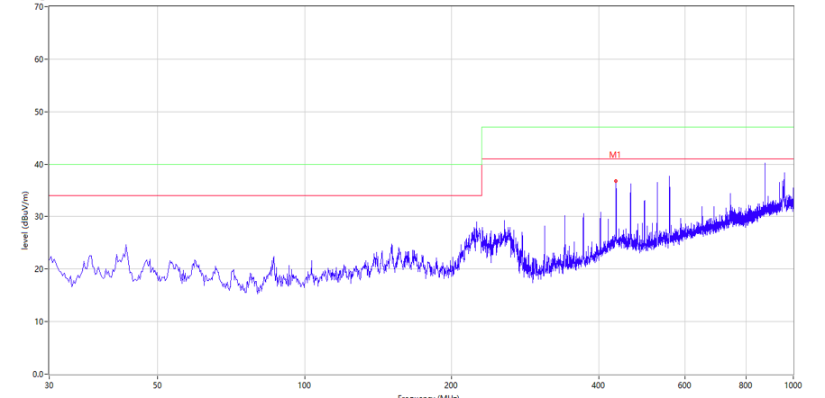
<figcaption>
图 1‑1 EMI测试图
</figcaption>
</figure>

每个正常工作的电路都会辐射EMI。辐射EMI的量取决于频率、电流、信号电流环路面积和电感。每个承载开关电流源的电流环路也是一个辐射体，因此也是一个环形天线。因此，每个电路都会辐射射频能量，即EMI。

### 接线干扰

当信号传播的传导路径为外接导线时，干扰能量沿着导线的电源线或者信号线以传导方式逸出。因此在接入外部导线传输时，导线的长短与路径阻抗，影响着测试结果，传导可能以下两种模式之一进行

共模：发生在噪声以相同相位出现在两根导体上时，如：信号的输出和回流。

差模：发生在噪声在两根导体上相位相反时。

由于接线端干扰路径比较单一，因此在进行EMI测试整改时，可以考虑去除接线，查看是否为导线干扰，在产品整改EMI，可以看出接线对EMI结果对比：

| 条件 | EMI测试图 | 结果 |
|----|----|----|
| 接入信号线 | 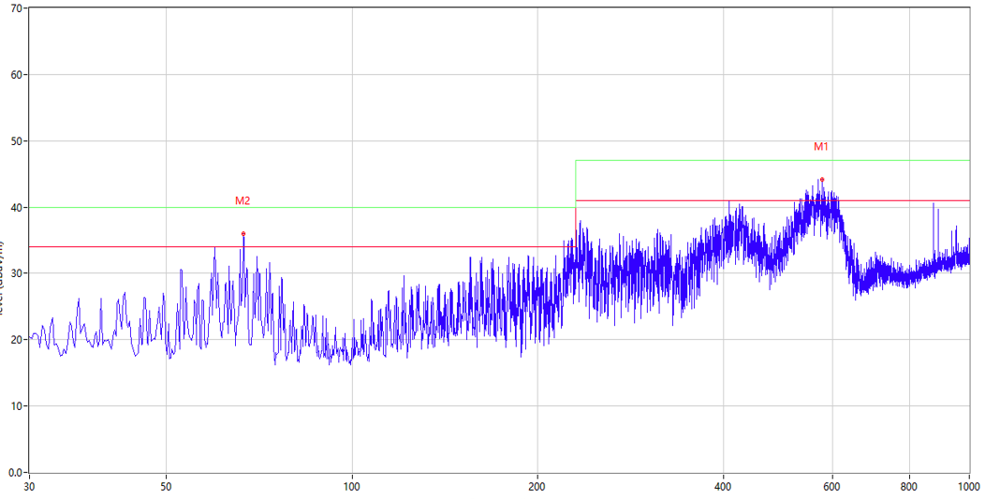 | 峰值过高 |
| 断开信号线 | 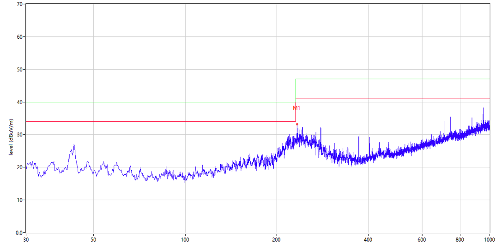 | Pass |
|  |  |  |

图 1‑2 EMI接线测试对比图

### 输出频率

对于频率影响EMI测试中可以可做成2点：1）当外部输出或当MCU以固定频率运行时，在扫描频率中在某个固定频率下会出现谐波，导致波峰的出现。2）引脚输出频率提高，随着信号电流的频率和变化率增加，辐射能量也随之增加。不同的频率下测试结果为：

| 条件        | EMI测试图                                   |
|-------------|---------------------------------------------|
| 系统频率48M | 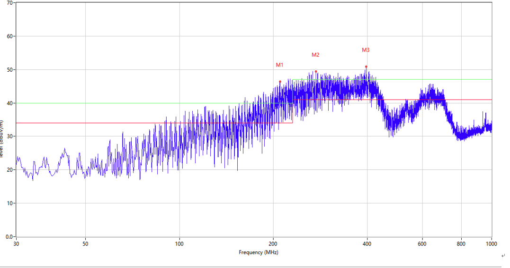  |
| 系统频率8M  | 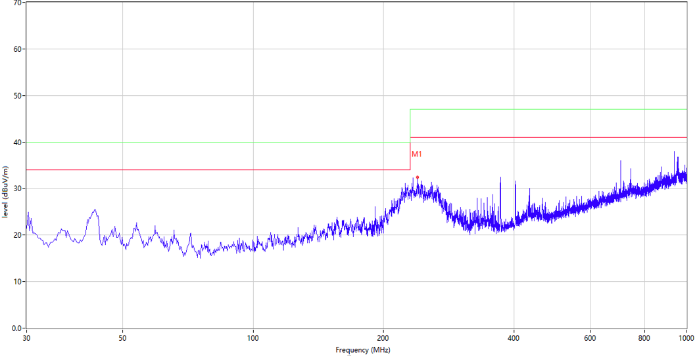  |

图 1‑3 EMI系统主频测试对比图

可以看出：相较于48M系统主频，当系统8M系统频率运行下EMI测试波峰幅值有所改善；但这只是为确定EMI干扰源提供一种思路；在某些情况下单纯降低运行速率并非可以改善EMI；也可以从以下条件进行考虑：1）改善电源端防护；2）减少IO引脚输出电流与反转速率。

### 输出引脚干扰

引脚输出干扰主要体现在：当MCU引脚输出引发的干扰，当引脚的高频开关电流，通过其所在的物理回路（信号与回流），形成有效的“无意天线”。信号电流从引脚流出，经负载后通过地平面回流，形成一个环路，根据法拉第电磁感应定律，变化的电流环会产生辐射，因此当PCB产生的天线环路面积越大；天线越大，辐射发射就越大。另一方面，当输出引脚输出信号时，回路电流在接收设备的GND与PCB公共GND存在阻抗产生压降，会产生一个共模电流，流向所有连接到该地的外部电缆，使得形成一根高效天线。

| 条件 | EMI测试图 |
|----|:--:|
| 断开发送引脚 | 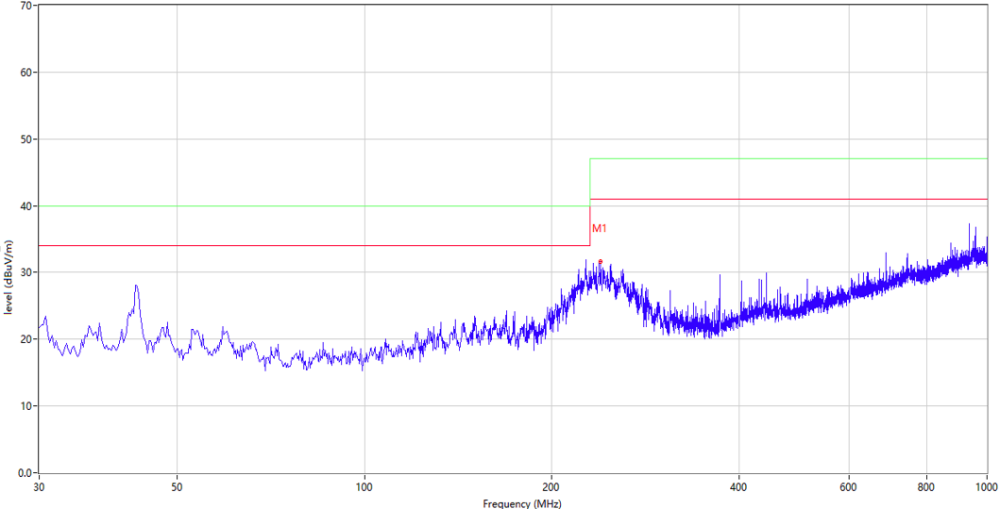 |
| 连接发送引脚 | 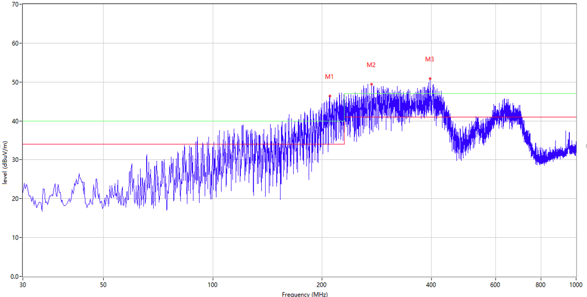 |

图 1‑4EMI输出引脚测试对比图

如上图所示；当排查EMI干扰时，可翘起发送端的GPIO，可排查是否由GPIO引起。

### 回路干扰

当传输信号与旁路的GND或者金属导体外壳形成非对称路径，当电流在两条路径上流入时，由于非对称结构，辐射场在远处无法相互抵消，因此导致辐射效应显著增加。

| 测试条件       | EMI测试结果                                 |
|----------------|---------------------------------------------|
| 旁路不接金属壳 | 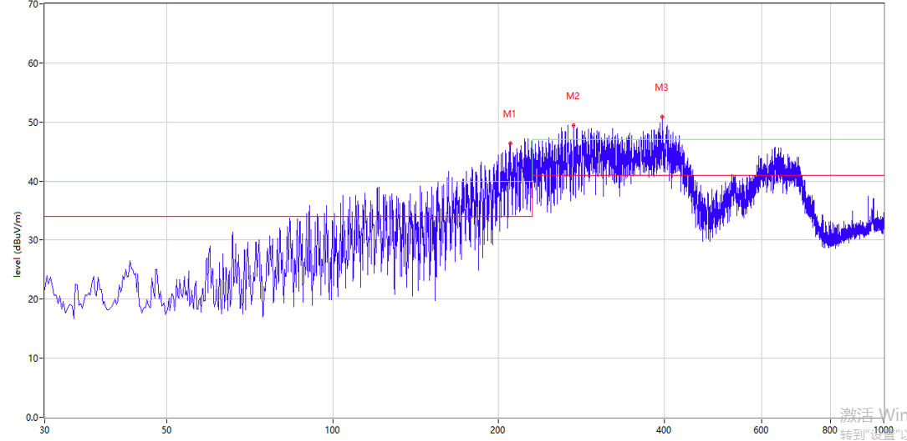  |
| 旁路接金属壳   | 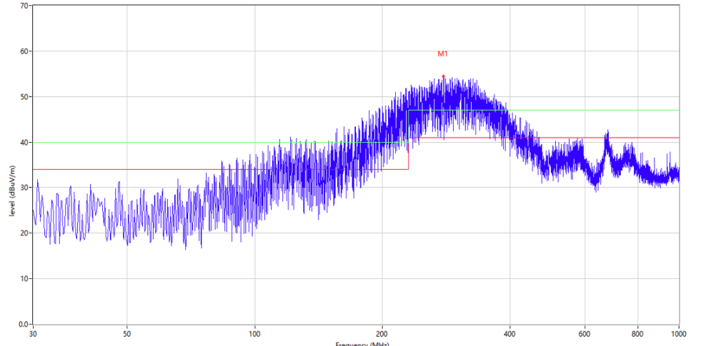  |

图 1‑5 EMI回路路径测试对比图

# EMI防护

## 硬件防护

EMI硬件防护应按照正确的层级顺序干预；先消弱源头能量，再通过改善传播路径，最后通过防护器件进行保护改善。

### 电源防护

一切无意天线都需要高频电流驱动，电源作为噪声离开设备出口，是最高效的无意天线；因此降低电压与电流变化，可有效减少辐射能量。

1）电容选择

选择电容器作为噪声滤波器时，用户应始终考虑电容器的两个重要特性：最高频率限制和自谐振；当在最高频率下自谐振是电容器不再表现为电容器而更像电感器的频率，不同容值典型自谐振频率参考表：

|  容值   | 引线式SRF | 贴片式SRF |
|:-------:|:---------:|:---------:|
|  1 µF   |  2.5 MHz  |   5 MHz   |
| 0.1 µF  |   8 MHz   |   16MHz   |
| 0.01 µF |  25 MHz   |   50MHz   |
| 1000pF  |  80 MHz   |  160MHz   |
|  100pF  |  250MHz   |  500MHz   |
|  10pF   |  800MHz   |  1.6 GHz  |

表 2‑1 不同容值典型自谐振频率

因此为了覆盖更宽频段，使用不同容值的电容并联（如10uF//0.1uf//0.01uf）。在选择容值间隔使用十倍或者十倍以上，使各电容的容性区间尽量衔接而不在关键频段产生谐振峰。

2）降低电压

在测试过程中，MCU供电电压由5V降低至3.3V可改善EMI测试结果，虽然降低电压不是改善主要因素，但也为EMI测试提供一种改善情况。降低电压意味着信号的摆幅越小，发射也相应减少。

3）电源防护

电源防护可选择前端串联磁珠与退耦电容端组成LC滤波，用于消除噪声信号。在使用磁珠时，应放在电容之前，靠近噪声源一侧，让噪声先被磁珠阻挡，再经过电容旁路。电源端除了连续的高频信号，还要面对浪涌与瞬态过压，因此可以添加TVS管抑制高压信号脉冲。

### 引脚防护

对于输出引脚防护既有共模电流干扰还会存在差模电流干扰；对于引脚输出时，其EMI风险主要来自引脚过快的边沿和阻抗失配引起的振铃。因此可以利用GPIO引脚输出端口最大速率配置用以减少引脚压摆率与驱动能力，进行限制输出跳变速率；以CH32通用系类为列，不同的速率参数见下图。

<figure>
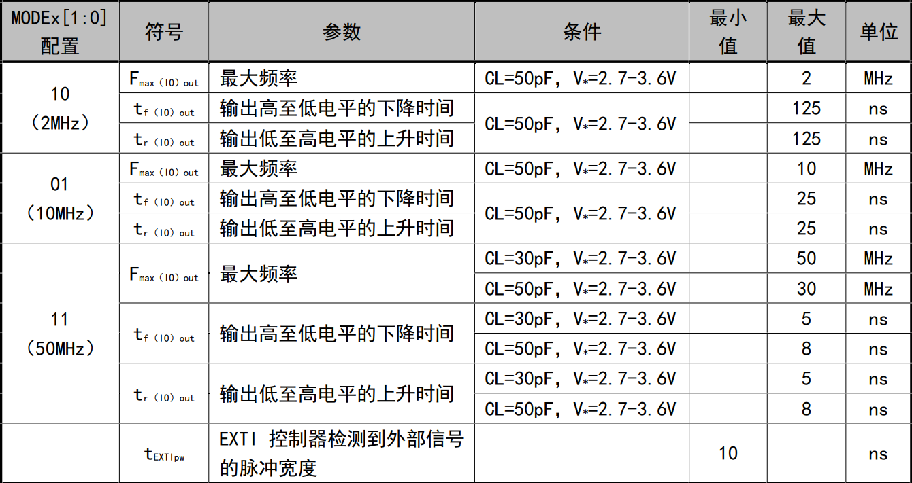
<figcaption>
图 2‑1不同的速率参数
</figcaption>
</figure>

可在引脚串联磁珠，可有效减小辐射，原理如图所示；通常FB2的阻抗值越大，辐射越小，但是磁珠本体部分参数需要兼顾，比如在同样的阻抗特性下，磁珠的L值越低越好，另外需要选好磁珠后，需要对磁珠的做个连续运行热测试和抓取下C3两端电容上电压过冲情况。若电压过冲较小，则D1可去除。R1和C3组成的RC，一方面减缓IO振铃，此外对FB2引发的过冲对IO进行保护。

<figure>
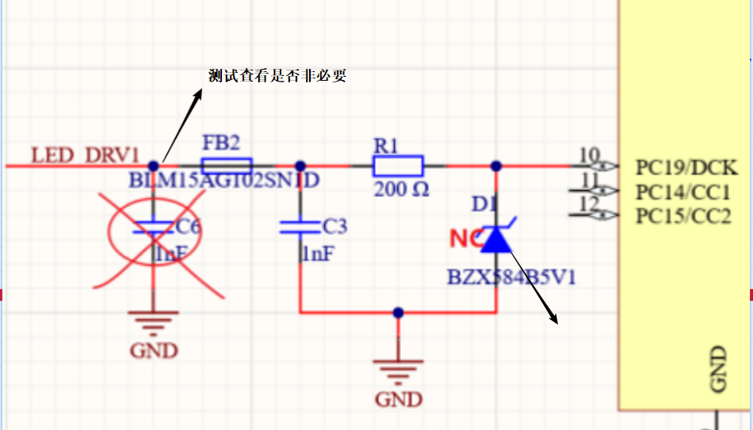
<figcaption>
图 2‑2 GPIO防护示意图
</figcaption>
</figure>

对比测试见图

| 测试条件    | EMI测试结果                                 |
|-------------|---------------------------------------------|
| 去除磁珠FB2 | 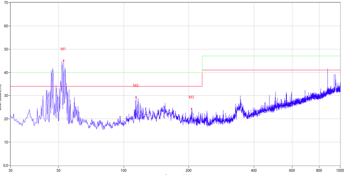  |
| 添加磁珠FB2 | 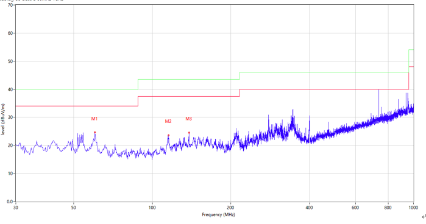  |

图 2‑3 GPIO防护对比图

## PCB改善

针对EMI的电路设计和PCB布局考量与功能性同等重要，尤其是需要一个完整的地；不要轻易分割地平面，高频回流走最低电感路径，地平面开槽会迫使回流，环路面具骤增。

### 信号线处理

经过测试由IO引脚产生的振铃，往往伴随在高频段出现问题，由于某些通讯的固定的通讯频率可能回引起在某个固定频率下会出现谐波，往往无法解决辐射过高的问题。因此需要在绘制PCB时，需要注意数据与时钟线间需要包地处理，底层有个完整的参考地平面。此外数据走线时应避免过孔从而导致传输路径阻抗不连续产生回流路径。当信号线必须过孔时，需要在信号附近放置地过孔，建议使用多个地过孔，用以减少回流阻抗。

| 良好的信号处理   | 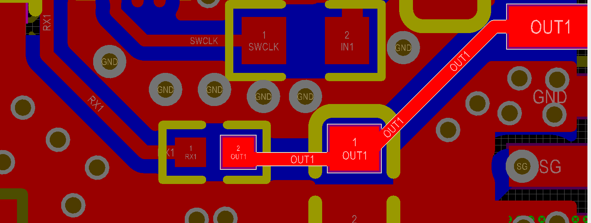   |
|------------------|---------------------------------------------|
| 不推荐的信号处理 | 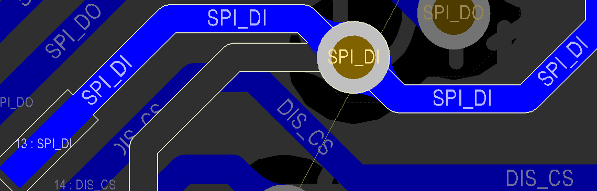  |

图 2‑4 信号处理对比图

如图所示：OUT为输出引脚，使用连线无过孔，且下层均为完整的参考地平面，走线时，附近使用地过孔用以减少回流阻抗；不推荐的布线，数据时钟线存在过孔，且过孔附近没有地过孔；下方也没有完整参考地平面，且存在信号分支。

对于不同的走线方式使用不同的条件结果间下图：可以清楚看到无法通过测试的均出现72M整数倍的辐射问题，原因是原程序使用SPI传输，且传输时钟为18M；因此可以看出EMI在整数倍的频率下存在EMI辐射超出阈值；且降低GPIO口的最高反转速率也无法改善（只消除高频情况干扰）。经过重新布局走线，消除了EMI干扰问题。

| 测试条件 | EMI测试结果 |
|----|----|
| 信号没有包地GPIO设置最高速率为50M | 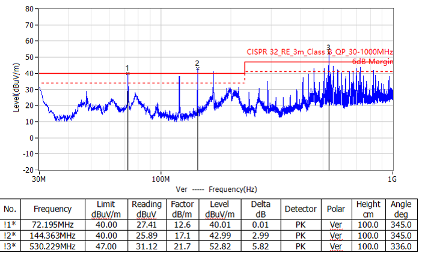 |
| 信号没有包地GPIO设置最高速率为2M | 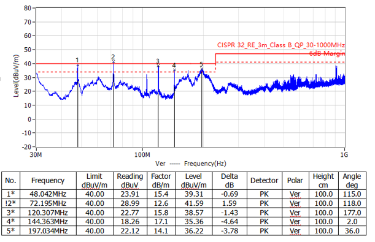 |
| 信号包地GPIO设置最高速率为2M | 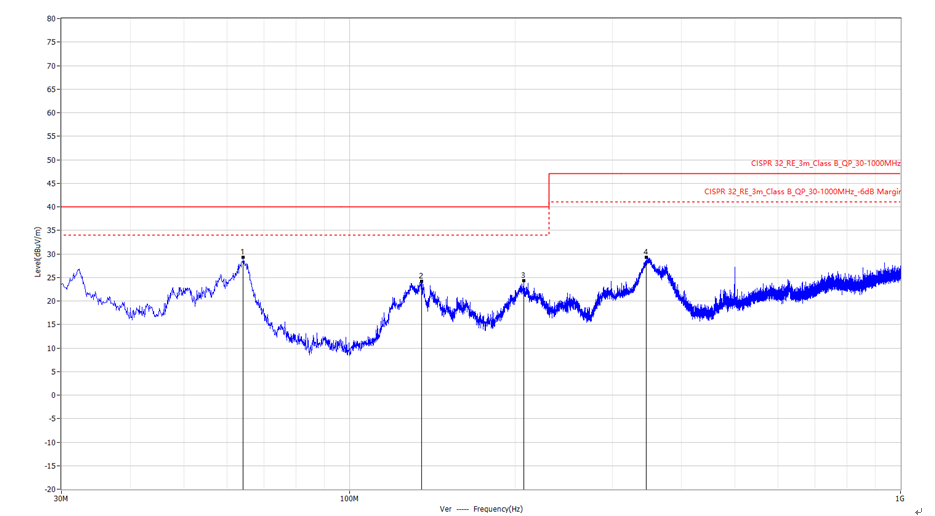 |

图 2‑5 GPIO处理结果对比图

此外对于板件接口线，应考虑采用多股接地线，采用信号线之间夹载GND的方式使用双绞线的方式进行传输，对于接收与输出端口考虑使用添加铜箔纸，与两端参考地大面积连接，用于降低两端输入阻抗差异。

图 2‑6双绞线示意图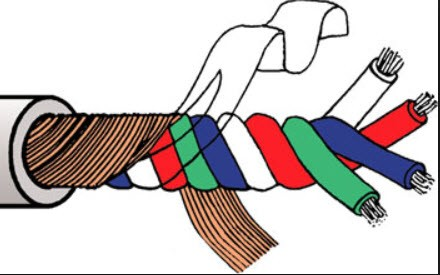

### PCB布板

1）电源信号布线

EMI辐射能量跟电流环路面积的大小呈强相关。在双层PCB上，不可能在板上的每个信号旁边都有连续不间断的接地走线，因为这会产生大的天线环路面积。天线越大，辐射发射就越大，尤其是对于高速信号。

2）退耦电容布局

对MCU
引脚电源处进行防护，磁珠必须选取高频阻抗高的规格，电容选取小封装规格，电容需和MCU
电源和GND 引脚尽可能的近，从而走线尽可能短，若PCB
贴装条件允许，各个电容的接地引脚可放置盘内孔。

| 不推荐布局，距离MCU 电源和GND 引脚较远且回路阻抗大。 | 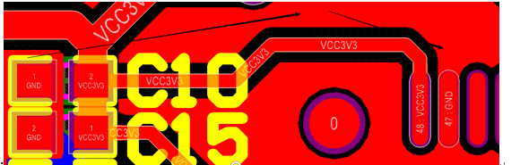 |
|:---|:---|
| 推荐使用布局靠近MCU 电源和GND 引脚各个电容的接地引脚可放置过孔。 | 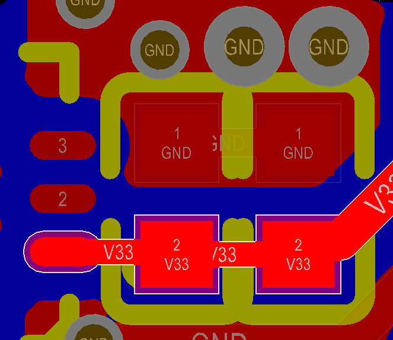 |

图 2‑7退耦电容布局对比

3）面板布板

建议使用多层面板布板，使用一面铺地，去耦电容等需多过孔近距离接地。若用铝基板则非常要注意地线处理，避免形成环形天线，可使用铝基层作为地平面，若无法特殊处理，尽量使用跳线电阻等充分接地。PCB返回信号线RX建议需同样串接RC和磁珠。

<figure>
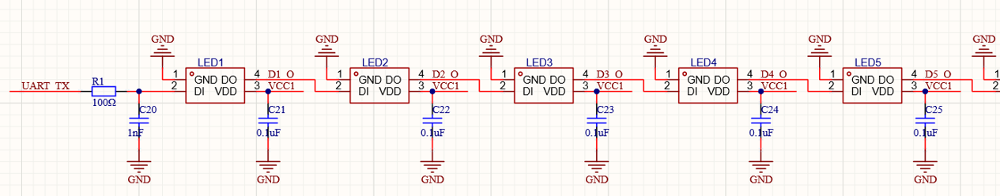
<figcaption>
图 2‑8 信号端处理
</figcaption>
</figure>

接口板尽量避免和设备端的地之间连接，避免整个系统形成变异偶极子天线。USB接口的外壳尽量不直接接GND，并且尽量远离接口板的走线，比如不要在USB接口下方铺地等操作。如下图所示，接口板为USB延长接口；更改后与外壳GND断开；USB接口下方不做铺地处理。

|     | 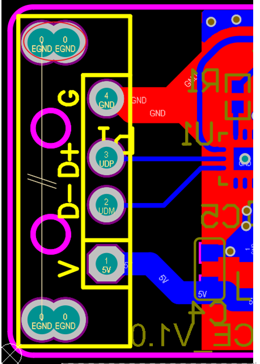   |
|-----|---------------------------------------------|
|     | 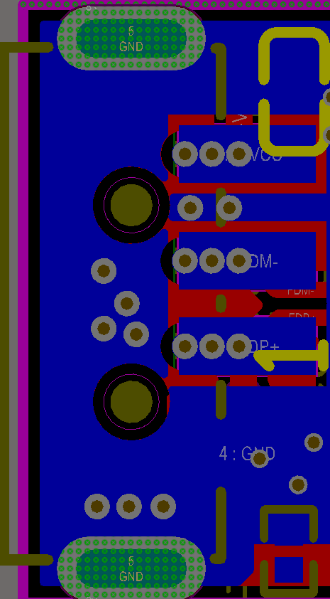  |

图 2‑9接口信号处理

此外在对差分和高速走线进行布局，在紧邻接地平面层的PCB第1层上保持差分阻抗匹配，此外确保所有时钟和高速信号走线下方具有不间断的参考接地平面，没有间隙或空洞，并且它们布线在第1层上。

## 软件处理

在对通讯没有精准的时钟要求可以使用展频技术对时钟信号进行持续、微小的调制；如SPI时钟为18M；使用内部时钟时，可以通过持续调节HSI的频率值使得SPI信号在某个区间范围进行变化，可以使能量不再集中某个单一的固定频率点，而是分散在某个频段范围内。使得峰值幅度削低从而有效抑制EMI。

历史版本

| 日期       | 版本 | 变更内容 |
|------------|------|----------|
| 2026/11/06 | V1.0 | 初版发行 |

声明

本手册仅供参考。作者在不另行通知的情况下，可随时进行修改。
